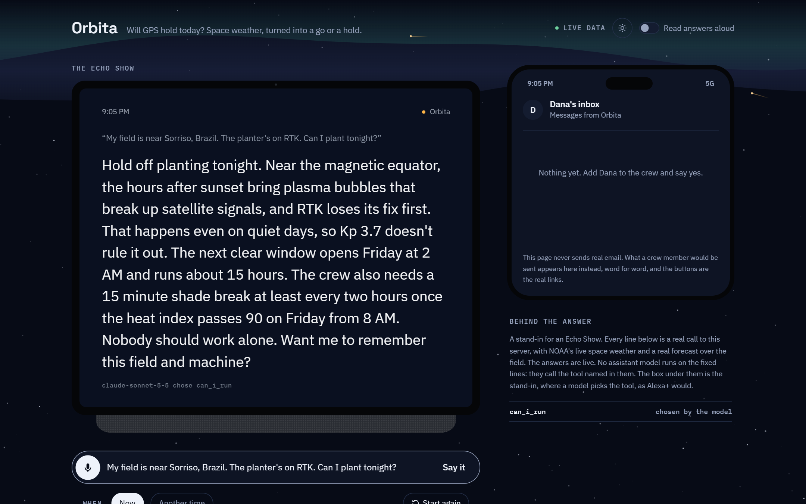
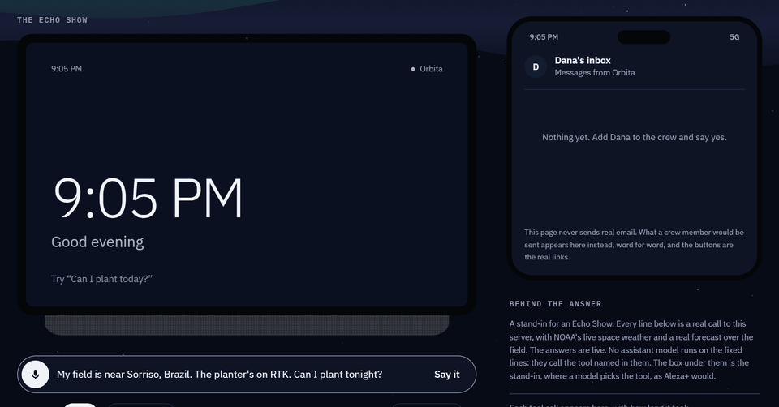
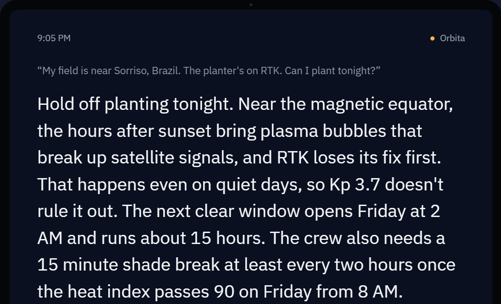
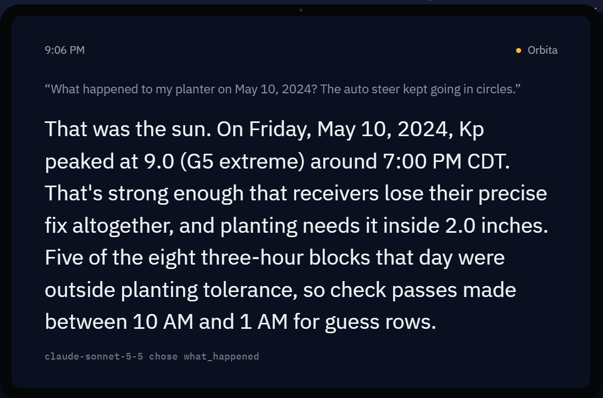
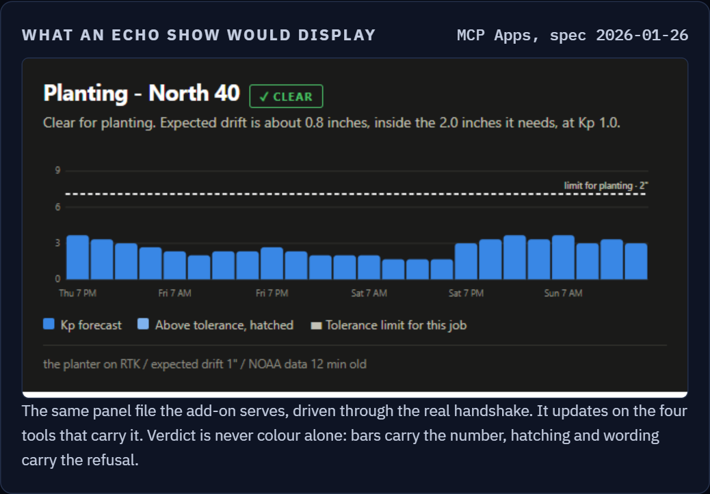
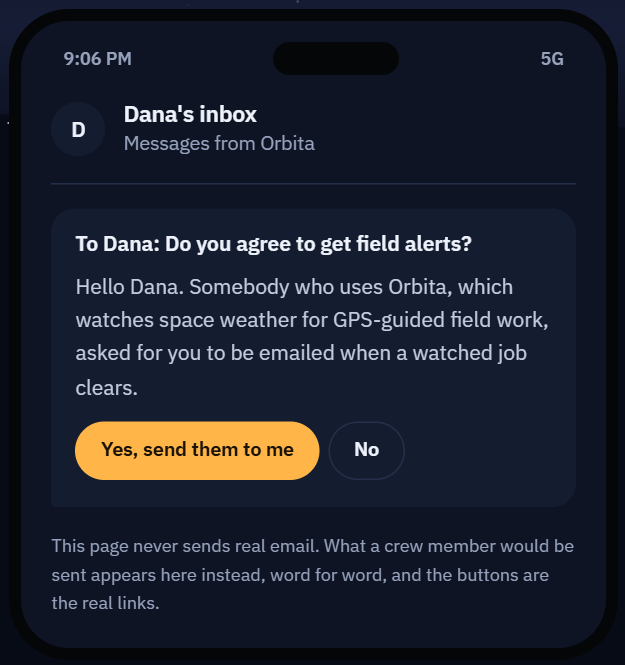
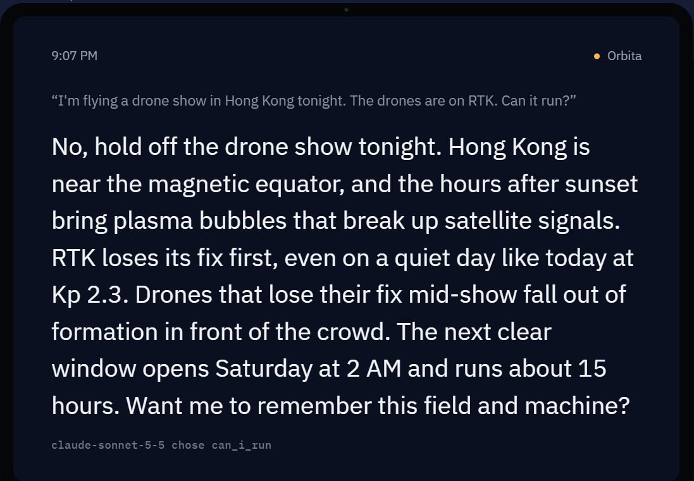
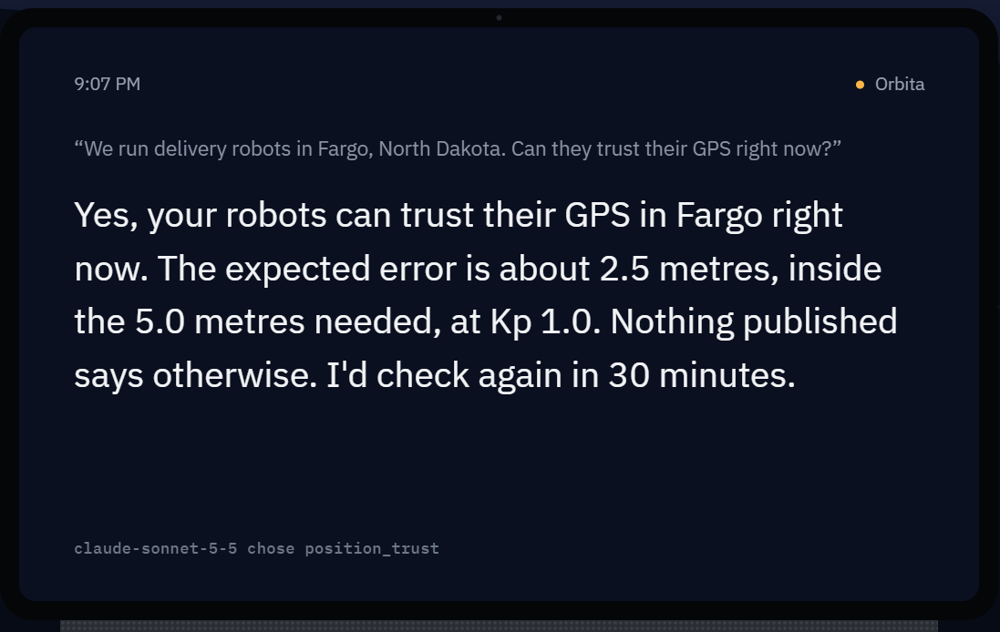
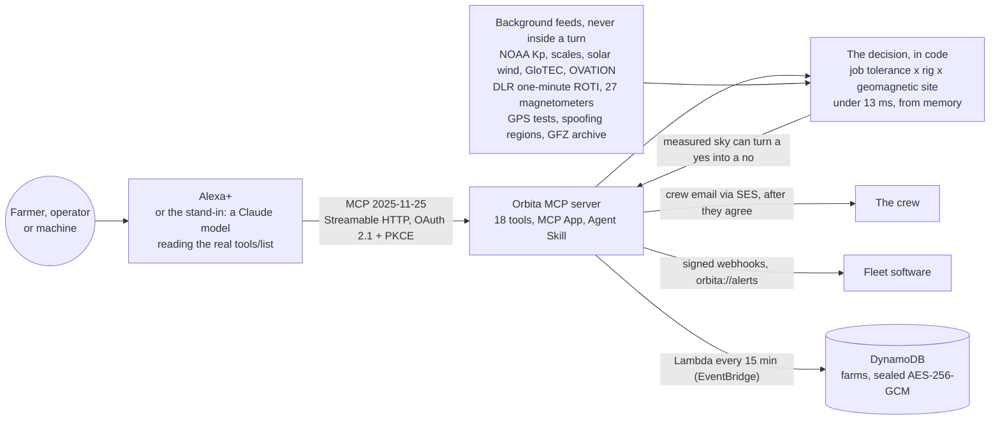

<div align="center">

<a href="https://ct5ae538t6.execute-api.us-east-1.amazonaws.com/echo.html?say=My%20field%20is%20near%20Sorriso%2C%20Brazil.%20The%20planter%27s%20on%20RTK.%20Can%20I%20plant%20tonight%3F&say=Watch%20it%20for%20me."></a>

# Orbita

**Will GPS hold today? An Alexa+ add-on that turns NOAA space weather into a go or a hold for this field, this
machine and this job, and tells everyone else a solar storm reaches what to do about it.**

[](https://github.com/nirbhay221/orbita/actions/workflows/tests.yml)
[](https://github.com/nirbhay221/orbita/actions/workflows/live-check.yml)


[](LICENSE)

**[▶ Try it live](https://ct5ae538t6.execute-api.us-east-1.amazonaws.com/echo.html)** ·
[The Echo Show panel](https://ct5ae538t6.execute-api.us-east-1.amazonaws.com/) ·
[Connect any MCP client](#run-it) ·
[Architecture](docs/ARCHITECTURE.md) ·
[Agent Skill](skills/orbita-gps-trust/SKILL.md) ·
[Friction log](FRICTION.md) ·
[For the judges](#for-the-judges)

<sub>Self-hosted MCP server (spec 2025-11-25, Streamable HTTP, OAuth 2.1 with PKCE) with an MCP Apps panel for the
Echo Show and an Agent Skill. Built for the Build, Ship, Shape: Amazon Developer Hackathon, Alexa+ track, with the
AWS Builder mini challenge. 18 tools by default.</sub>

<br>



<sub>Recorded from the live server on 22 October 2026, 9:05 PM Pacific. Nothing is sped up except the waiting.</sub>

</div>

## In 20 seconds

On 10 May 2024 a G5 storm hit the Midwest in the middle of planting. Tractors stopped at the ends of their fields;
in South Dakota the screen showed the tractor "going in circles". NOAA had put out a watch days before, in Kp and G
levels. Nothing told a farmer what that meant for **this** field and **this** machine, or when it would clear.
Orbita does.

- **"Can I plant tonight?"** near Sorriso, Brazil, on a quiet day: **hold off**. Near the magnetic equator, plasma
  bubbles after sunset break the RTK fix whatever Kp says. A Kp app calls that night clear.
- **"What happened to my planter on May 10, 2024?"** That was the sun: Kp 9 (G5), five of eight blocks outside
  planting tolerance, and the hours whose passes to check for guess rows.
- **"Watch it for me."** It watches the job and emails the crew when it clears, and only after each person has
  agreed on their own phone.
- **A machine asks too.** Robots, drones, fleets and spacecraft get `trust`, `verify` or `do_not_trust`, for up to
  1,000 positions in one call, with signed alerts pushed to the fleet's own software.
- **23 kinds of operator** get timed steps from the same data: satellites, grid rooms, airlines, ships, undersea
  cables, data centres, small planes, households.
- **The model talks; code decides.** Every verdict and number is computed from NOAA, the measured sky and the other
  published sources, so no model can turn "hold off" into "probably fine".

## Try it now, no Echo needed

Every ▶ opens the [live demo](https://ct5ae538t6.execute-api.us-east-1.amazonaws.com/echo.html) and says the lines
for you, on a new farm of its own. A Claude model reads this server's real tool list and plays Alexa+; the tools run
on AWS against today's NOAA data, so the numbers follow today's sky.

| Who | Say | What comes back |
|---|---|---|
| A farmer in Nebraska | ▶ [Can I run strip-till today?](https://ct5ae538t6.execute-api.us-east-1.amazonaws.com/echo.html?say=The%20North%2040%2C%20near%20Grand%20Island%2C%20Nebraska.%20The%20strip-till%20bar%27s%20on%20RTK.%20Can%20I%20run%20strip-till%20today%3F) | Saved in one sentence, then go or hold: drift in inches against the 2 inches the job needs, and when it clears |
| The same farmer, looking back | ▶ [What happened on May 10, 2024?](https://ct5ae538t6.execute-api.us-east-1.amazonaws.com/echo.html?say=The%20North%2040%2C%20near%20Grand%20Island%2C%20Nebraska.%20The%20planter%27s%20on%20RTK.&say=What%20happened%20to%20my%20planter%20on%20May%2010%2C%202024%3F%20The%20auto%20steer%20kept%20going%20in%20circles.) | The storm replayed for that field from the archived Kp record, and which passes to check |
| A farmer in Brazil | ▶ [Planting tonight, on a quiet day](https://ct5ae538t6.execute-api.us-east-1.amazonaws.com/echo.html?say=My%20field%20is%20near%20Sorriso%2C%20Brazil.%20The%20planter%27s%20on%20RTK.%20Can%20I%20plant%20tonight%3F&say=Watch%20it%20for%20me.) | A hold for the evening plasma bubbles, then a watch. In Brazil's evening, about 4 to 10 PM Pacific, it says when the job clears |
| The same farmer, a month on | ▶ [How many hours did space weather cost me?](https://ct5ae538t6.execute-api.us-east-1.amazonaws.com/echo.html?say=My%20field%20is%20near%20Sorriso%2C%20Brazil.%20The%20planter%27s%20on%20RTK.&say=How%20many%20hours%20did%20space%20weather%20cost%20me%20this%20month%3F) | About 200 hours in the last 30 days when this was written, nearly all evening bubbles, and the worst day |
| A crew boss | ▶ [Fit twelve hours of strip-till into the clear hours](https://ct5ae538t6.execute-api.us-east-1.amazonaws.com/echo.html?say=The%20North%2040%2C%20near%20Grand%20Island%2C%20Nebraska.%20The%20strip-till%20bar%27s%20on%20RTK.&say=I%20need%20twelve%20hours%20of%20strip-till%20done%20in%20the%20next%20three%20days.%20When%20should%20we%20run%20it%3F) | The hours placed in the blocks the NOAA forecast leaves clear over the next three days |
| A satellite operator | ▶ [Will the next three days throw off our orbit predictions?](https://ct5ae538t6.execute-api.us-east-1.amazonaws.com/echo.html?say=I%20operate%20satellites%20in%20low%20Earth%20orbit.%20Will%20the%20next%20three%20days%20throw%20off%20our%20orbit%20predictions%3F) | Drag and conjunction confidence by storm phase, with the protons GOES measures right now |
| A drone show in Hong Kong | ▶ [Can it run tonight?](https://ct5ae538t6.execute-api.us-east-1.amazonaws.com/echo.html?say=I%27m%20flying%20a%20drone%20show%20in%20Hong%20Kong%20tonight.%20The%20drones%20are%20on%20RTK.%20Can%20it%20run%3F) | A hold for the evening hours and the clear ones, the answer Hong Kong's 2024 shows needed |
| A robot fleet in Fargo | ▶ [Can they trust their GPS right now?](https://ct5ae538t6.execute-api.us-east-1.amazonaws.com/echo.html?say=We%20run%20delivery%20robots%20in%20Fargo%2C%20North%20Dakota.%20Can%20they%20trust%20their%20GPS%20right%20now%3F) | Trust, verify or do not trust, the expected error against the need, and when to ask again |
| A survey crew in India | ▶ [Can we work near Ludhiana?](https://ct5ae538t6.execute-api.us-east-1.amazonaws.com/echo.html?say=Can%20my%20survey%20crew%20work%20near%20Ludhiana%2C%20India%3F%20We%27re%20on%20RTK.) | The sun, and what is not the sun: the India and Pakistan border is on the FAA's list for spoofing |
| A grid control room | ▶ [Anything to get ready for this week?](https://ct5ae538t6.execute-api.us-east-1.amazonaws.com/echo.html?say=I%20run%20a%20grid%20control%20room%20in%20Minnesota.%20Is%20there%20anything%20we%20should%20get%20ready%20for%20this%20week%3F) | Whether the forecast calls for its disturbance procedure, from NERC's template |
| A household | ▶ [Will it hurt my phone?](https://ct5ae538t6.execute-api.us-east-1.amazonaws.com/echo.html?say=There%27s%20a%20solar%20storm%20on%20the%20news.%20Will%20it%20hurt%20my%20phone%20or%20anything%20in%20the%20house%3F) | No, and it says so: a storm does not damage phones, cars or anything in the house |

<sub>Each link plays at most three lines, the stand-in's burst for one visitor. The stand-in has a daily cap of 150
model calls; past it, word rules choose the tool and the screen says so. [Health and today's budget](https://ct5ae538t6.execute-api.us-east-1.amazonaws.com/health).</sub>

## See it

<table>
<tr>
<td width="50%"><br><b>Brazil, a quiet night.</b> Held for the plasma bubbles near the magnetic equator, which no Kp number shows. The watch clears Friday at 2 AM.</td>
<td width="50%"><br><b>May 10, 2024, replayed.</b> The field's own day, in its own time, from the archived record, and which passes to check.</td>
</tr>
<tr>
<td><br><b>The Echo Show panel.</b> An MCP App: three days of forecast against the job's own limit. Go and hold are never red against green; position, hatching and words carry it.</td>
<td><br><b>The crew agrees for themselves.</b> The public demo never sends email, so what Dana would get appears on her phone, with the real agreement links.</td>
</tr>
<tr>
<td><br><b>A drone show in Hong Kong.</b> Called off in 2024 on a quiet night. Orbita holds it and names the clear hours, as Shenzhen did.</td>
<td><br><b>A robot fleet.</b> One word a machine can branch on, the reasons, and when to ask again.</td>
</tr>
</table>

## Why it matters

- **The loss is measured.** Kansas State University puts the May 2024 storm at an assumed $565 million in losses to
  Midwest crop producers, in the middle of planting
  ([K-State, 2025](https://www.ksre.k-state.edu/news-and-publications/news/stories/2025/04/agriculture-solar-weather-gps-outage.html)).
  Auto-steer runs on more than half the US acres planted to corn, soybeans, winter wheat and cotton
  ([USDA ERS](https://ers.usda.gov/data-products/charts-of-note/106187)).
- **It was not a one-off.** In November 2025 another superstorm pushed GPS error past ten metres coast to coast;
  the paper that measured it says that in planting season "it could have led to significant losses for the American
  farming and transportation industries" ([Yizengaw et al. 2026](https://doi.org/10.1029/2026GL124645)).
- **Quiet days break fixes too.** Hong Kong called off its 2024 National Day drone shows minutes before the start at
  Kp 1, for ionospheric scintillation
  ([SCMP](https://www.scmp.com/news/hong-kong/society/article/3280850/why-did-shenzhens-national-day-drone-show-go-ahead-not-hong-kongs)).
  A third of the world farms within 20 degrees of the magnetic equator, where that happens every evening in season.
- **Nobody translates it.** Aviation and grid operators are told. Alexa's weather alerts come from the National
  Weather Service, and space weather comes from a different NOAA centre. The existing space weather MCP servers
  expose the feed; none says what a farmer, a satellite team or a household should do, or when
  ([Prior art](#prior-art)).

## Not a Q&A bot

The hackathon's rules name what makes an Alexa+ entry creative rather than obvious. Each is here, and used for a
reason:

| The rules say | Orbita |
|---|---|
| Agentic workflow across services | Every answer names the next step and carries the chain it is on (`flow`): hold, then when it clears, watch it, tell the crew, log the job, report the week. The stand-in follows read-only steps on its own; a [Strands agent](#a-strands-agent-that-follows-the-chain) follows the whole chain and waits for a yes before anything is saved or sent |
| Context-aware, state across sessions | Fields, machines and their corrections, watches, a job log, crew contacts who agreed to be emailed, a second person given read-only access with a one-time code |
| Media support, cards | Cards and lists for watches, reports, confirmations and sharing codes (`ui/card.html`) |
| MCP Apps | The Echo Show panel (`ui/window.html`): the full MCP Apps handshake, display modes, and the host's theme |
| Agent Skills | [`skills/orbita-gps-trust`](skills/orbita-gps-trust/SKILL.md), checked by the format's own validator, and readable from the server itself as `skill://` resources |
| Beyond the list | Elicitation to ask which field instead of guessing; a task for the 45 day season plan; a heat check for the crew from the sister add-on Sudor, over MCP, with nothing about anyone's health crossing |

## How it decides



**The full design is in [docs/ARCHITECTURE.md](docs/ARCHITECTURE.md)**: ten diagrams GitHub draws and lets you zoom,
covering what runs where on AWS, a voice turn step by step, the go-or-hold decision, the storm alert path, the
DynamoDB record, crew consent, security and deployment, with the decisions behind them. A printable copy is
[docs/architecture.pdf](docs/architecture.pdf).

Three things sit between the NOAA data and an answer, and none of them is a model:

- **The job sets the tolerance.** Planting and strip-till 2 inches, spraying 20, tillage a metre, cadastral survey
  3 centimetres, a drone show a decimetre.
- **The rig sets the baseline.** RTK gives centimetres on a quiet day and degrades hardest in a storm; long
  baselines lose it first. WAAS starts coarse and degrades gently.
- **The site sets the exposure, by geomagnetic latitude, not the map.** Winnipeg and Kyiv share a parallel and not a
  storm. Near the magnetic equator, the evening hours in season are a hold on their own.

What is measured outranks what is forecast. The disturbance over the field in the last few minutes, from about 4,000
satellite links, can turn a forecast yes into a no; the ionosphere's measured slope across the base station distance
can too. A source that could not be read is never counted as clear.

## Measured, not claimed

| What | Result | Where |
|---|---|---|
| Speed, every tool over HTTP | p95 under 13 ms in memory; three tools in a row 12.3 ms, against Alexa+'s roughly 500 ms | [LATENCY.md](LATENCY.md) |
| Against real receivers | Agrees with five-minute GPS station positions at Saskatoon, Fargo, Grand Island and Lubbock in 93 to 96 percent of 2024's blocks | `evals/receivers.mjs` |
| Fitted on one year, tested on the next | The one judgement in the model, fitted on 2024 and scored on 2025: held 35 of 43 storm blocks where receivers lost precise positioning | [CALIBRATION.md](CALIBRATION.md) |
| Three planting seasons replayed | "Not now" in 1 to 5 percent of blocks, on the days that had real storms | [BACKTEST.md](BACKTEST.md) |
| What operators actually did | May 2024, November 2025 and January 2026: 22 of 22 recorded actions matched | `evals/may2024.mjs`, `evals/storms.mjs` |
| Tool choice, from spoken sentences | 100 percent of 87 on Opus 5.5, a regression baseline rather than a blind score | `evals/golden.json` |
| Whole conversations | 36 of 37 turns right, in the patterns real users were recorded in | `evals/conversations-last-run.json` |
| Automated checks | 2,467 on every push, on Node 20 and 22, plus the stack, DynamoDB Local and the Strands agent | [`.github/workflows/tests.yml`](.github/workflows/tests.yml) |
| The live demo, while it is judged | Checked twice a day against the deployed server with no model and no cost: fresh NOAA data, the May 2024 replay, a go or a hold, a position check, the demo page | `scripts/live-check.mjs` |

## For the judges

The detail below is long because the reasoning is the work. This is the map, in the order of the judging criteria.

- **Tech Implementation.** A self-hosted MCP server on spec 2025-11-25 over Streamable HTTP, the official SDK called
  at runtime ([`src/server.ts`](src/server.ts), [`src/tools.ts`](src/tools.ts)). Account linking is OAuth 2.1 with
  PKCE in the static-client shape Alexa+ actually uses ([Getting it in front of Alexa+](#getting-it-in-front-of-alexa)).
  Elicitation, a task, tool annotations, output schemas and structured results that name the next step. Feeds are
  polled in the background, so every answer is arithmetic from memory.
- **Design.** Written to be heard once with busy hands: the verdict, the number in the job's own units, when it
  clears, the rest held for "tell me more". Setup is one sentence by the nearest town. Questions say why before they
  ask, one at a time. Local units and the local free correction in all 12 countries Alexa+ is in
  ([How the conversation is designed](#how-the-conversation-is-designed)).
- **Potential Impact.** A measured loss, a recurring hazard, and a fixed audience: anyone steering by a satellite
  position, plus 23 kinds of operator a storm reaches ([Why it matters](#why-it-matters),
  [Everyone else the storm reaches](#everyone-else-the-storm-reaches)).
- **Quality of the Idea.** Not a native Alexa+ feature, not a wrapper around a feed, and every item on the rules'
  creative list ([Not a Q&A bot](#not-a-qa-bot), [Why it is not a wrapper around a feed](#why-it-is-not-a-wrapper-around-a-feed)).

The requirements, one by one:

- **Alexa+ track.** A working self-hosted MCP server, and the simulated Alexa+ experience the rules allow while MCP
  add-on access is in preview: the demo page, where a Claude model reads the real tool list, calls the tools over MCP
  and speaks the reply ([An Alexa+ stand-in](#an-alexa-stand-in)). The server is the one Alexa+ would call.
- **Under 500 ms.** Under 13 ms at p95 for every in-memory tool ([LATENCY.md](LATENCY.md)).
- **Open source.** Apache-2.0 ([LICENSE](LICENSE)); [why not AGPL](#licence).
- **Setup and run instructions.** [Run it](#run-it), and [`deploy/README.md`](deploy/README.md) for AWS.
- **Built in the window.** First commit 18 September 2026, after the 31 August start.
- **Third-party data.** Every source with its terms in [What is real, and what is not](#what-is-real-and-what-is-not);
  data whose terms do not allow this use is off by default.
- **AWS Builder.** EC2 behind an API Gateway HTTP API, S3 and SSM Run Command for deploys, SSM Parameter Store for
  keys, SES for crew email, Polly for the spoken demo, and in CDK ([`infra/`](infra/)) a DynamoDB farms table and the
  alert check as a Lambda started by EventBridge Scheduler, with CloudWatch alarms to SNS. The agent in
  [`strands/`](strands/) is built on AWS's Strands Agents SDK. Summary in [PRODUCT_FEEDBACK.md](PRODUCT_FEEDBACK.md).
- **Friction log.** [FRICTION.md](FRICTION.md): ten dated entries from building against the Alexa+ documentation,
  each with what was expected, what happened, the workaround and a suggested fix.

## Run it

```bash
npm install && npm run build
npm start                 # demo page on http://localhost:8788, MCP endpoint on /mcp
# or, with only Docker:
docker build -t orbita . && docker run -p 8788:8788 orbita
```

The data feeds need no keys. The stand-in uses `ORBITA_ANTHROPIC_KEY` if it is set; without it, word rules choose the
tool and the screen says so. Account linking is off locally and on in production (`ORBITA_AUTH=on`).

**Any MCP client.** The deployed server is remote over HTTPS, the shape every compliant host takes: Claude, ChatGPT in
developer mode, Cursor, VS Code, Windsurf, Cline, Zed. It sits behind account linking; to look without an account:

```bash
node skills/orbita-gps-trust/scripts/connect.mjs https://ct5ae538t6.execute-api.us-east-1.amazonaws.com/mcp --demo
```

```json
{
  "mcpServers": {
    "orbita": { "type": "streamable-http", "url": "https://ct5ae538t6.execute-api.us-east-1.amazonaws.com/mcp" }
  }
}
```

**Tests.** `npm test` runs 2,467 checks; [Running it](#running-it) lists every suite and what it covers.

## What's here

| Folder | What it is |
|---|---|
| [`src/`](src) | The MCP server: [`domain.ts`](src/domain.ts) is the decision, [`tools/`](src/tools) the 18 tools, one file per job, and one file per data feed beside them |
| [`web/`](web) | The demo pages: the Echo stand-in with a crew member's phone (`echo.html`) and the panel page with every example (`index.html`) |
| [`ui/`](ui) | The MCP Apps the add-on serves: the Echo Show panel and the card |
| [`skills/`](skills/orbita-gps-trust) | The Agent Skill, also served by the server as `skill://` resources |
| [`strands/`](strands) | A Strands agent that follows each answer's next step |
| [`evals/`](evals) | Tool choice, whole conversations, real receivers, calibration, three storms replayed |
| [`infra/`](infra) | CDK: the farms table, the scheduled alert check and its alarms |
| [`deploy/`](deploy) | The instance, its hardening, secrets and the deploy script |
| [`docs/`](docs) | The architecture: ten diagrams and the decisions behind them, and a PDF of it |

## What Alexa+ would need

Everything below works in the demo; some of it works around what an add-on cannot do yet. The dated detail is in
[FRICTION.md](FRICTION.md).

| Gap | What Orbita does instead | What would make it real |
|---|---|---|
| An add-on cannot speak first | Emails the crew, after they agree, when a watched job clears and the evening before a storm; pushes signed alerts to a fleet's software | A proactive announcement for add-ons, rate limited per household |
| No way to test an add-on on a device | A stand-in model plays Alexa+ against the real tool list and says so in every response | A test path for MCP add-ons while access is in preview |
| Account linking is not the generic MCP OAuth shape | A static client, Alexa's redirect URIs per region, registration closed once it is set | The QuickStart saying so up front |
| Nothing says whether the host retries a call | A two-minute repeat window, and the host's request id where one is sent | A documented retry identifier |
| Display modes are declared by the view, not the tool | Followed the MCP Apps specification instead of the page | One corrected sentence in the Display Modes page |

## The detail

Everything above, argued and sourced. Each section opens on a click.

<a id="what-it-answers"></a>
<details>
<summary><b>What it answers</b></summary>

A storm on the sun reaches a lot more than the sky. It moves satellite positioning off its line, blacks out HF
radio on the daylit side, drives current into power lines, pipelines and rails, raises radiation on polar flights
and in orbit, and takes away the vertical guidance small planes land on. NOAA publishes all of it, live and free,
in a form written for scientists. Orbita reads it and tells each person what it means for the thing they look
after, where it is, and when to act.

GPS-guided work is where it goes deepest, because that is where the loss is measured. For a farm or a crew, Orbita
remembers the fields, machines and correction type, and answers for that job:

| Ask | What happens |
|---|---|
| "Can I plant today?" | Go or hold off for this field, this machine and this job's tolerance, and when it clears |
| "Is it safe to fly the mapping drone?" | The same, with the trade's own risk: a flight cannot be redone, and the compass is upset too |
| "My rows were crooked yesterday at 3, was it the sun?" | That hour, in the field's own time; and if it was not the sun, what to check instead |
| "What is the sun doing?" | Kp now and ahead, NOAA's alerts, in plain words |
| "Tell Dana when it clears" | The crew is emailed when a watched job clears, and the evening before a storm |
| "Can we run, with the crew in mind?" | A crew member's heat day from the sister add-on Sudor, never their health |
| "Can I fly the drone tonight in Pune?" | Near the magnetic equator, the evening plasma bubbles that break GPS on quiet days are a hold too |
| "Can I spray this afternoon?" | Rain forecast over the field is said for spraying and drone jobs, and that GPS itself is unaffected |
| "I need twelve hours of planting this week" | The hours placed in the clear windows of the next three days, one job per machine per hour |
| "How many hours did storms cost me this month?" | The hours a job would have been held, the worst day, and how many were evening bubbles rather than storms |

It works anywhere: exposure is computed from geomagnetic latitude, so a field in Punjab, Bavaria or Patagonia is
judged where it actually sits. Satellite teams, grid rooms, airlines, HF radio, timing, pipelines, drilling, rail,
vessel positioning, ships, undersea cables, mining, fleets, robots, magnetic surveys, small plane pilots, satellite
services, aurora watchers and households get advice for their work from the same data.

**In every country Alexa+ is in** (the US, Canada, Mexico, Brazil, the UK, Germany, Austria, France, Italy, Spain,
Australia and India, October 2026), two things it says change at the border while the verdict does not
(`src/region.ts`). Drift is said in centimetres outside the US, and miles become kilometres outside the US and the UK.
And the setup question names the free satellite correction a farmer there knows: WAAS in North America, EGNOS in
Europe and the UK (whose open signal still reaches British fields after the UK left the programme in 2021), GAGAN in
India, SouthPAN in Australia, and PPP in Brazil, which has no SBAS of its own. Official warnings, the language Alexa+
answers in, and where planned GPS tests are and are not published were already handled per country.

The Latin `orbita` meant a track cut into the ground by a wheel. Built for the
[Build, Ship, Shape: Amazon Developer Hackathon](https://amazonappdev2026.devpost.com), Alexa+ track, with the AWS
Builder mini challenge. Self-hosted MCP server, spec 2025-11-25, Streamable HTTP, 18 tools by default, with an MCP
Apps panel for the Echo Show.

</details>

<a id="one-storm"></a>
<details>
<summary><b>One storm</b></summary>

Orbita turns NOAA space weather into decisions: whether a farm job, a machine or a spacecraft can trust its
position right now, and what a satellite operator, a grid room, an airline or a household should do about a storm.

On 10 May 2024 a G5 storm hit in the middle of planting. "All the tractors were sitting at the ends of the field," a
Nebraska farmer [told 404 Media](https://www.404media.co/solar-storm-knocks-out-tractor-gps-systems-during-peak-planting-season); in South Dakota the screen showed the tractor "going in circles" and auto-steer would not
engage. In March 2026 a military GPS exercise on the North Carolina coast did the same to farms that had no
warning at all. NOAA had put out a storm watch days before May 10, in Kp and G levels; nothing told a farmer what
that meant for this field and this machine, or when it would clear.

| The farmer says | Orbita |
|---|---|
| "Can I plant the North 40?" | Hold off, why in inches against what planting needs, and when the next clear window opens |
| "Alright, watch it for me." | It watches, and asks who on the crew should be emailed when it clears |
| "Yesterday afternoon the tractor was going in circles while we were planting, what happened?" | Whether the sun explains that hour on that field; if not, which other published cause does (a military test, a region where GPS is spoofed), and what to check |
| A delivery robot, an autonomous sprayer or a satellite asks the same server | One word it can act on: trust, verify or do not trust, with the reasons and when to ask again; "and in ten minutes?" is judged from the forecast for that time, and says so |

**Who it is for, in three groups.** Field work (farms, surveyors, drone mappers, grade crews), machines that act on
a position (robots, drones, autonomous equipment, spacecraft), and everyone else the same storm reaches (satellite,
grid, airline, HF radio, timing and data centre, pipeline, drilling, rail, vessel, mining, fleet and aurora). The
first is the story; the other two are the same data, asked differently.

**The model talks; code decides.** The assistant's job is to understand the farmer. Every verdict and number is
computed by code from NOAA and the other published sources, so no model can turn "hold off" into "probably fine". It
never says trust when a reading could not be had.

**Tested the way people talk.** Sixteen conversations in the patterns real users were recorded in (farmers' own
words from May 2024, repeats, "never mind", "what about tomorrow though", "why not", corrections), played turn by
turn against the real tools, got 36 of 37 turns right on Opus on 16 October (`conversations.mjs`,
`evals/conversations-last-run.json`). The first run, of fourteen, scored 32 of 33. Its miss was a delivery robot asking "and in ten minutes?", which the model
rightly said the position check could not answer ahead of time. That was a gap, so the check now takes `inMinutes`
and judges that time from the forecast, and the same conversation then went 2 for 2
(`evals/conversations-rerun-machine.json`). The two added in October are a delivery robot going on to
when its fix clears, and a ferry; the run with them cost $0.28. Its one miss was the
ferry officer's "and what else should I do", which the model sent to `tell_me_more`, as that tool's description says
to; but `tell_me_more` had nothing held for advice that reads its own steps, so it would have said there was nothing
more while steps were waiting. It now reads the next page of that advice, the turn accepts either tool, and the
recorded result is the run as it was.

</details>

<a id="what-is-real-and-what-is-not"></a>
<details>
<summary><b>What is real, and what is not</b></summary>

Nothing here is mocked for the demo. Where something stands in for a thing we could not reach, it is named.

| Part | Status |
|---|---|
| MCP server, 18 tools by default | **Real and deployed** on AWS, behind account linking. 2,467 automated checks, run on every push |
| Agent Skill | **Real**: `skills/orbita-gps-trust`, to the open Agent Skills format, passing the format's own validator. Installable as a folder, and readable from the server as `skill://` resources |
| Strands agent | **Real**: `strands/agent.mjs`, on AWS's Strands Agents SDK. It reads the skill from the server and follows each next step. The chain, the yes before a write and the step cap are checked with a scripted model at no cost; the path through Claude needs a key and is not in the automated checks |
| Space weather: Kp forecast and nowcast, solar wind, ionosphere map, aurora oval, alerts | **Real, live feeds** from NOAA SWPC, polled in the background, never inside a turn |
| The sky over the field, measured | **Real, live**: the German Aerospace Center's one-minute disturbance readings (ROTI) from about 4,000 satellite links worldwide, read within 400 km of the field. Free for scientific use. Orbita is free and open source and sells nothing, so it uses the data on those terms. Commercial use would need the IMPC's written permission, so anyone who runs a copy commercially can set `ORBITA_ROTI=off` and the forecast then decides alone. We thank DLR who is maintaining the IMPC services |
| Ground magnetometers | **Real, live**: 16 USGS observatories (the United States, plus Guam, Honolulu, San Juan, Kakioka and Hermanus) and 11 more through INTERMAGNET in Germany, Belgium, Poland, Sweden, Spain and Australia. INTERMAGNET data is CC BY-NC 4.0, free for non-commercial use, which is how Orbita uses it; a commercial copy sets `ORBITA_INTERMAGNET=off` |
| Ground electric field, HF absorption | **Real, live**: NOAA's geoelectric field model (lower 48 and Canada) and D-RAP (worldwide), read at the place an operator names |
| What is not the sun: GPS tests, satellite outages, spoofing regions, aircraft-reported interference | **Real, live**: the Coast Guard's GPS testing schedule and satellite outage file, which cover the United States. The Coast Guard's site refuses automated reads from cloud servers with a 403, the deployed one included, so the outage file is read from CelesTrak's mirror, and the testing schedule from the FAA's own flight advisories for the same tests on FAASafety.gov, which give each test's centre, its radius at 50 feet and its hours in UTC, so a test counts only while it is on. Elsewhere a quiet schedule is never said as "no test": the answer says that planned tests there are announced to pilots by NOTAM, which the UK CAA and Australia's Defence publish in a form that cannot be read automatically. **Real, from the regulators**: the regions the FAA (March 2026) and EASA (July 2026) list for routine jamming and spoofing, drawn as boxes around the regions they name. GPSJAM's daily aircraft reports publish no licence, so they are **off unless switched on** |
| The past: "what happened at 3 pm on May 10 2024" | **Real**, from the archived Kp record, by the hour |
| Crew heat | **Real**: Open-Meteo's hourly forecast over each field |
| Kp to expected drift | **A model**, anchored to three published measurements, its one judgement fitted on real receivers for 2024 and tested on 2025 ([CALIBRATION.md](CALIBRATION.md), [BACKTEST.md](BACKTEST.md)) |
| Emails to the crew | **Real**, through Amazon SES, only after the crew member agrees. The account is in the SES sandbox (production access requested), so today it reaches verified addresses only. The public demo shows the email in an inbox panel instead |
| The talking demo | **Real model**: Claude Sonnet 5.5 reads the real tool list and picks a tool, as Alexa+ would. With no model available, word rules pick instead, and the screen says which |
| Alexa+ itself | **Not available to us.** MCP add-on access is in preview |
| Echo Show panel | **Real MCP App**, tested against a simulated host. Not seen on a real device |

</details>

<a id="the-problem"></a>
<details>
<summary><b>The problem</b></summary>

In May 2024 a solar storm knocked GPS accuracy out across the Midwest at the peak of planting.

* Farmers stopped planting across the Midwest, Nebraska and Kansas among the worst hit
* Position errors reached about 33 feet, ten metres, against an RTK spec of two centimetres
* Growers described tractors as "acting possessed", and John Deere dealerships sent warnings
  that accuracy was "extremely compromised"
* Kansas State University puts the losses to Midwest crop producers at an assumed $565 million ([K-State](https://www.ksre.k-state.edu/news-and-publications/news/stories/2025/04/agriculture-solar-weather-gps-outage.html))
* Auto-steer and guidance ran on more than half the US acres planted to corn, soybeans, winter wheat and cotton by
  2019 ([USDA ERS](https://ers.usda.gov/data-products/charts-of-note/106187)), and modern equipment is too wide to run without it

It was not a one-off. In November 2025 another superstorm pushed GPS error past ten metres
again, coast to coast, and this time the auroral oval reached Florida. Yizengaw et al. measured
it in *Geophysical Research Letters* ([10.1029/2026GL124645](https://doi.org/10.1029/2026GL124645),
2026) and drew the conclusion this project is built on:

> If the November superstorm onset had occurred during farming season in the American sector,
> it could have led to significant losses for the American farming and transportation industries.

The same May 2024 storm reached far past farms. About half of all active satellites in low orbit
manoeuvred at once and collision avoidance was compromised for about three days. Planet paused
imaging, a UK cubesat was powered down, and ICESat-2 dropped into safe hold. United flew a
transatlantic flight south of its usual track to keep its communications. Grid control rooms ran
their geomagnetic disturbance procedures on about six hours' notice.

NOAA saw it coming. Aviation was told. Grid operators were told. The person with 600 acres and a
machinery loan found out when the planter started wandering, and assumed he had broken something.

</details>

<a id="what-it-does"></a>
<details>
<summary><b>What it does</b></summary>

```
"Alexa, can I plant the North 40 today?"

"Hold off planting. Kp 6.3 (G2 moderate) puts expected drift near 0.7 metres,
 about 34 times your normal 0.8 inches, and planting needs it inside 2 inches.
 Next clear window opens Thursday 7pm and runs about 51 hours."
```

```
"Alexa, I run satellites. What should I do about this storm?"

"A geomagnetic storm at G5 and a solar radiation storm at S2 are running now.
 Treat conjunction warnings as low confidence for about three days. In May 2024
 collision avoidance was compromised that long, and about half of all active low
 orbit satellites manoeuvred at once. Choose deliberately between safe mode and
 staying in service. ... There is 1 more step, ask me for the rest."
```

The second answer is real output from `probe.mjs`, replaying a G5 storm with R3 radio blackouts
and an S2 radiation storm. On a quiet day, which is most days, every role gets one plain sentence
saying nothing needs doing, rather than silence or invented urgency.

It is not a space weather dashboard. Kp means nothing to a farmer and "G3" means little to a
household. The product is the translation from the forecast into this field, this machine, this
job, this control room, go or no go, and what to do and when.

</details>

<a id="why-it-is-not-a-wrapper-around-a-feed"></a>
<details>
<summary><b>Why it is not a wrapper around a feed</b></summary>

Three things sit between the NOAA data and a field answer.

**The job sets the tolerance.** Planting has to be inside about 2 inches, because those rows must
be findable again at cultivation and at harvest, so an error today is an error all season. Spraying
gets about 20 inches because boom section control absorbs more. Tillage gets a metre. Cadastral
survey gets 3 centimetres, because a boundary you set wrong is a legal problem rather than a yield
problem.

**The rig sets the baseline.** RTK gives centimetres on a quiet day but degrades hardest in a storm,
because it assumes the ionosphere is similar over the baseline and that assumption is exactly what
a storm breaks. Long baselines lose it first. WAAS starts coarse and degrades gently.

**The site sets the exposure, and not by the latitude on the map.** Storms follow the magnetic
field. The geomagnetic pole sits around 80.65N 72.68W, roughly 11 degrees off the geographic one,
so two places on the same parallel are not equally exposed. Winnipeg and Kyiv both sit at 49.9
north; Winnipeg is at 58 degrees geomagnetic and Kyiv at 47, and Winnipeg takes the harder hit from
the identical storm. It runs the other way too: Punjab at 30.9 north is only 22.8 geomagnetic and
safer than the map suggests, while Perth at 31.95 south is 41.2 and more exposed. This uses a
centred dipole conversion, so the answer is correct in either hemisphere.

It also separates two cases that look identical from the outside: the sun being the problem, and
the rig never having met that tolerance anyway. It only offers to wait when waiting would help.

</details>

<a id="why-a-field-is-the-vulnerable-case"></a>
<details>
<summary><b>Why a field is the vulnerable case</b></summary>

Self-driving cars are barely affected by this, and the reason is instructive. They are deliberately
built not to depend on GNSS, localising instead against LiDAR maps, inertial measurement and vision.
Tunnels and urban canyons kill GPS routinely, so operating without it is a designed-for condition.

A tractor in a bare field has nothing to localise against. No lane markings, no buildings, no
landmarks, just dirt that looks identical in every direction. GPS is not one input among many, it is
the only absolute reference there is. The SLAM literature makes the same point from the other side,
naming large open fields alongside tunnels as geometrically degenerate environments where LiDAR
localisation itself slips.

The places with nothing to look at are the places that break.

</details>

<a id="not-only-farms"></a>
<details>
<summary><b>Not only farms</b></summary>

**Machines nobody is watching.** The sharpest version of this problem is not a
farmer in a cab noticing the rows wander. Next generation tractors, harvesters and
drones are built to run "continuously and independently, minimizing labor", which
means the thing that would have caught the drift has been deliberately removed.
Research on space weather and positioning names the exposed sectors as security,
autonomous transportation, precision agriculture and financial transactions, and the
documented symptoms in agriculture are missed lines, weaker repeatability, and time
spent reacquiring position. An unattended machine accumulates all three before
anybody reads a report.

**The low altitude drone economy.** That is the name now given to drones and air taxis working below 3,000 m on
logistics, inspection, public safety and urban air mobility
([JEIT, 2026](https://jeit.ac.cn/article/doi/10.11999/JEIT251246)). It has already met space weather. On 30
September and 1 October 2024 Hong Kong called off its National Day drone shows over Victoria Harbour minutes
before they started: the drones could not hold a strong satellite fix, and the organisers and the government put
it down to ionospheric scintillation. Kp was 1. Shenzhen's shows across the border went ahead, because they could
be moved to when it was safe
([SCMP](https://www.scmp.com/news/hong-kong/society/article/3280850/why-did-shenzhens-national-day-drone-show-go-ahead-not-hong-kongs),
[HKBU](https://tyr-jour.hkbu.edu.hk/2024/10/03/national-day-fireworks-light-up-victoria-harbour-but-drone-show-cancelled-again/)).
That is the case a Kp-only answer gets wrong, since it says go on a quiet night. Victoria Harbour is 13 degrees from
the magnetic equator in equinox season, and Orbita, given those evenings and RTK drones, says hold off for both and
clear at midday and after midnight, which is the Shenzhen answer (`test-hongkong.mjs`). An earlier version of this
paragraph quoted a 2026 *Space Weather* paper on drones that could not be found again, so the quote is gone.

**Everything else that surveys from the air.** Drone mapping is routine in
construction, mining, energy and utilities, forestry, archaeology, real estate,
insurance and infrastructure inspection, and RTK surveying gets 1 to 3 centimetres
horizontally when it works. Every one of those breaks the same way for the same
reason, and every one already has a tolerance it is working to, which is the input
this add-on needs.


The same ionosphere degrades every trade that stands on GNSS, and the engine does not change
between them: same Kp, same geomagnetic latitude, same baseline penalty. Only the tolerance differs.

| Job | Needs inside | Why that number |
|---|---|---|
| Cadastral and engineering survey | 3 cm | 2 to 3 cm horizontal is what RTK or PPK with placed control reports; a boundary is a legal record |
| Drone survey | 5 cm | sub-5 cm on a disciplined workflow, and the aircraft is moving, so there is no second pass |
| Drone show | 10 cm | hundreds of drones a few metres apart on RTK, which [Geoscan reports](https://insidegnss.com/two-thousand-simultaneous-drones-position-themselves-with-gps-and-glonass-rtk/) holding to about 1 cm; 10 cm, ten times that, is this project's line, since no published tolerance was found |
| Machine control on grade | 5 cm | dozers, graders and excavators plan around 20 to 50 mm horizontal; past that you move dirt twice |
| Planting, strip-till | 5 cm | rows must be findable again at cultivation and harvest |
| Spraying, harvest | 50 cm | boom section control absorbs more |
| Tillage | 1 m | |

</details>

<a id="everyone-else-the-storm-reaches"></a>
<details>
<summary><b>Everyone else the storm reaches</b></summary>

`what_should_i_do` answers by what the person looks after. Each role has its own trigger, taken
from the source that describes the effect, and its own steps for each phase of a storm.

| Role | Acts from | What it tells them | Where that comes from |
|---|---|---|---|
| Satellite operator | G2, or S2 | Orbit predictions degrade; defer ground maintenance and decide on launches a day ahead; treat conjunctions as low confidence for about three days; choose safe mode or service deliberately; fresh orbit determination and a propellant budget afterwards | NOAA scales; Parker and Linares (2024); Knipp, National Academies (2025); LaNeve et al. (2025) |
| Grid control room | G3, or G2 at high magnetic latitude | A day ahead: black start readiness, crews on notice, return outaged equipment and delay planned outages if studies support it. Hours ahead: watch reactive reserves, MVAR swings, harmonics, transformer heating; 10 A of GIC per phase is the starting point for concern. During: hold reserves, unload susceptible equipment, act on two indicators | NERC GMD Operating Procedure Template; NERC May 2024 event review |
| Airline dispatch and crews | S1, R3 or G4 | Advisory in the flight packet; delay what can wait; otherwise a lower latitude, lower altitude track, with United's UAL 990 as the worked example; extra fuel; no reliance on HF alone; an approach that does not depend on WAAS; from S3, an unexplained avionics fault treated as possibly radiation and reported | LaNeve et al.; Frontiers (2025); NOAA scales |
| HF radio | R1, S1, or G2 at high latitude | A non-HF fallback; how long an R2 or R3 blackout lasts; route around the poles in a radiation storm | NOAA scales |
| GPS timing | G3 | A backup timing source; how long you can run without GPS time; check systems re-acquired cleanly | CISA ICSA-11-084-01; NOAA scales |
| Drone pilot | G1 | Check Kp before launch; practise attitude mode; keep the aircraft close; postpone mapping at G3 | Drone Academy; NOAA scales |
| Pipeline integrity | G3, or G2 at high latitude | Move cathodic protection surveys out of the storm; flag readings taken during it | Divett et al. (2023); NOAA scales |
| Directional drilling | G2, or G1 at high latitude | Line up geomagnetic referencing; do not mistake a storm for a failed tool; hold magnetic surveys without a reference | Halliburton; British Geological Survey |
| Railway signalling | G4 | Treat unexplained signal changes as possibly storm induced, and log them | Boteler (2021); Patterson et al. (2023) |
| Vessel positioning | G1 | Put satellite position loss in the risk assessment and set the point where you reduce capability or stop; line up an inertial, acoustic, radar or laser reference and prove it works first; watch for scintillation after dark, worst from about an hour after local sunset to midnight; fall back rather than hold on a degraded fix | IMCA information note on solar activity and GNSS |
| Automated mining | G1 | Centimetre corrections drop out and autonomous haulage stops rather than guesses; move survey and blast hole setting out away from the worst hours; run on inertial or manual; re-check anything positioned during the storm before drilling on it | Scientific Reports, unmanned mine trucks under weak GNSS; RTI for NIST (2019) |
| Vehicle fleets | G3 | Ordinary tracking rides through most storms, so it stays quiet until the strong end: satellite messaging in remote areas, yard equipment that needs centimetres, and rough geofences and arrival times at G4 | RTI for NIST (2019); NOAA scales |
| Aurora watchers | G1 | How far south NOAA says aurora has been seen at that level | NOAA scales |
| Households | G5 | Charge phones and keep a torch ready; storms do not damage phones, cars or anything in the house; satellite internet can be slow, as Starlink reported in May 2024 | NOAA scales; The Register (May 2024) |
| Small plane pilots | G4 | Plan as if LPV is not there, with an alternate on LNAV minimums or an ILS; check WAAS NOTAMs; fly LNAV minimums if that is all the box gives. In May 2024 WAAS lost LPV and LP over the lower 48 and Alaska for about fifteen hours while LNAV kept working | FAA WAAS Discrepancy Report 158; FAA SatNavNews (2024) |
| Magnetic surveys | G1 | Plan flying days around the storm, since specifications call 5 nT in 5 minutes or 10 in 10 unfit and lines outside tolerance are flown again; stop during storms of any size and check the base station before the next line | Australian Bureau of Meteorology; USGS Open-File Report 02-98 |
| Robots | G3 | Wire free mowers and yard robots use the same RTK fix tractors lost in May 2024: no unattended runs over storm nights, and a stopped robot stays parked; at G5 a safe stop for anything that needs the cloud. It says no robot case is on record | Ingenioren (May 2024); NOAA scales; this project's receiver study |
| Ships | G3, or R2 | Brief the watch and check radar, compass and terrestrial fixes before it; during it cross-check GNSS against radar and visual fixes, navigate on them if they disagree, and report to the Coast Guard Navigation Center; keep another way to reach shore when HF fades | US Coast Guard, GNSS: Trust, But Verify (2016); NOAA scales |
| Undersea cables | G4 | Check each power feed's voltage headroom against its route; TAT-8 saw 700 V Earth potential swings in March 1989 and rode through, and Google's study found margin for a once in a century storm; during it, read fast power feed swings as the storm before dispatching anyone | Medford et al. (1989); Boteler et al. (2024); Castellanos et al. (Google) |
| Satellite services | G3 | A fallback for satellite TV, satellite imagery or a data feed before it; during it and in the day after, short outages are the storm: GOES-16 stopped sending all data for nearly two hours on 13 May 2024, a day after the peak | DLR; May 2024 storm record |
| Field crews | G1, or R3 | Hands over to the go or no go for their own field and rig. While a strong flare runs, a rare solar radio burst can drown GPS on the daylit side for minutes, as in December 2006 | this project; Cerruti et al. (2008) |

**It is timed.** Each answer is in one of five phases: quiet, a watch one to three days out,
imminent within the day, during, and after. A grid control room two days from a G3 hears about
black start units, not redispatch. Forecast times are said in UTC, because that is what operators
run on.

**It reads the ground where they are.** Tell it the place once ("our substation near Fargo") and it is
remembered. A grid room, a pipeline or a railway then hears NOAA's modelled ground electric field at that
spot, next to the one published reference point, NERC TPL-007's once in a hundred years case of 8 volts
per kilometre, and the 12 it added for local peaks. NOAA gives no line for when the field matters and asks for caution in acting on its maps,
so Orbita never calls a number dangerous. An HF station or a dispatcher hears which frequencies are
being absorbed over them and NOAA's recovery estimate. A magnetic survey or a drilling crew within 600 km
of an observatory hears what that magnetometer is doing. What each reading will not do matters as much:
on a calm day a few millivolts are kept in the data and not read out, the ordinary daytime absorption
below 5 MHz is never mentioned, a place off a map gets no number, and a magnetometer 1,000 km away is
not handed over as the customer's own (`src/ground.ts`, `test-ground.mjs`).

**Flares and proton events only come with odds.** NOAA publishes day ahead probabilities for radio
blackouts and radiation storms, not timings, so those roles move to a watch at a 25 percent chance
and always say the actual number.

**It never makes the operator's call.** A 2025 survey of operators found many chose to stay in
service through the 2024 storms because losing service cost more than the risk. So it puts the
safe mode trade in front of a satellite team instead of deciding it.

**Voice rules hold.** No more than three steps are read aloud at a time, the rest are offered, and
nothing spoken refers to a screen.

</details>

<a id="what-else-the-storm-is-hitting"></a>
<details>
<summary><b>What else the storm is hitting</b></summary>

`what_else_is_affected` reads all three NOAA scales, not just G.

| Scale | What it lands on |
|---|---|
| G1 | Guidance error grows. Induced currents in transmission lines, weak voltage fluctuation |
| G2 | Grid voltage alarms, transformer damage possible in a long storm. The same currents run in pipelines and railway signalling. Satellite **timing**, which is not satellite position. Orbit predictions and satellite orientation. Directional drilling surveys |
| G3 | Drag on low orbit. A minor to moderate storm in February 2022 brought down 38 of 49 Starlink satellites from one launch, and 12 more Starlinks re-entered around the May 2024 storm |
| R1 | Shortwave between 1 and 30 MHz fades on the daylit side, which is what long-haul aircraft, ships, emergency services and amateurs are using |
| S1 | Radiation over the poles, so airlines move off polar routes and drop altitude |

It also says the thing most coverage gets wrong: **a storm does not touch your phone, your car or
anything in the house.** There is a test asserting the spoken answer never claims otherwise.

</details>

<a id="data"></a>
<details>
<summary><b>Data</b></summary>

Free NOAA and USGS products, no API key, no documented rate limit.

The forecast, which is where this started:

* `noaa-planetary-k-index-forecast.json` for 3-hourly Kp, observed and forecast, about 3 days out
* `alerts.json` for issued alerts, warnings and watches
* `noaa-scales.json` for G, S and R: today's levels, yesterday's, and the three day outlook, where
  R and S are day ahead probabilities rather than levels. The server stores each level as the
  digit NOAA sends, because the feed's text field is a word ("moderate") and reading that word as a
  code once made every real storm look quiet
* solar wind speed and magnetic field at L1, and an estimated Kp updated every minute

What was measured rather than predicted:

* **GloTEC**, a global map of total electron content on a 5 by 2.5 degree grid every ten minutes.
  This is the physical quantity that actually delays a GNSS signal. See the next section
* **INTERMAGNET observatories**, the ground magnetic field at one sample a minute: the USGS's own, and
  eleven in Europe and Australia through INTERMAGNET's node at the British Geological Survey
* **Dst** once a minute, the ring current index, which is the global companion to those observatories
* **OVATION Prime**, an aurora probability for every one degree cell on Earth

The rest of the catalogue, each one for somebody this add-on already answers:

* **ICAO space weather advisories**, the formal product civil aviation runs on. Orbita was answering
  an airline dispatcher out of the generic NOAA scales while the product written for them sat unread
* **GOES X-ray flux** at one minute, so a flare shows up while it is happening rather than in
  tomorrow's summary. The R scale is defined on this channel
* **WSA-Enlil**, a model of the whole inner heliosphere, which is the only feed here that gives days
  of warning rather than minutes
* **45 day Ap and F10.7**, the only feed on the timescale of the decision it informs. A planting
  season is not a three day question
* **Solar flare and proton probabilities** for the HF radio operator and the dispatcher, and
  **electron fluence** for the satellite operator
* **D-RAP**, NOAA's world map of the highest HF frequency losing at least 1 dB to absorption, for the
  HF operator and the dispatcher, read at the place they name
* **The geoelectric field**, NOAA's one minute model of the electric field in the ground over the lower
  48 and Canada, in millivolts per kilometre, from the 3D empirical model where it covers and the 1D one
  elsewhere, as NOAA recommends. This is what drives current into power lines, pipelines and rails

NOAA's live products reach back about seven days. For older questions the retrospective uses the
GFZ Potsdam archive, who produce the Kp index itself and publish the full record free without a key. When GFZ does not
answer, as on 22 October 2026, NOAA's own daily geomagnetic records are read instead: its last thirty days live,
and the quarterly files for May 2024 and the past year, kept here because they are final (`src/noaa-archive.ts`).

Polled on a 15 minute background timer, never inside a tool call. If NOAA is unreachable the server
says so rather than guessing, because a wrong go-ahead costs a season.

**The minute, not just the block.** The Kp forecast comes in three hour blocks, which is right for planning a
day and wrong for "is it turning right now". Two more feeds answer that: an estimated Kp updated every minute,
and the solar wind measured at L1, about 1.5 million kilometres upstream. At the speed the wind is travelling,
what that spacecraft sees reaches Earth 30 to 80 minutes later, and that gap is the warning. Since June 2026 the
measurements come from NOAA's SOLAR-1, the first spacecraft built for this rather than borrowed from a science
mission.

What makes a storm is a southward field, so a strongly negative Bz is what gets said out loud, with its caveat:
the field can turn back north before it arrives, and then nothing happens. The two summary feeds are about sixty
bytes each, so polling them every minute costs nothing.

One definition of "right now" is shared by every tool. Without it, storm_status answered Kp 3.7 while can_i_run
answered 3.3 in the same minute, which is how a customer stops believing the rest of it.

Times are said where the field is. Each field's timezone is looked up once from Open-Meteo when it
is added, in the background because that lookup takes about as long as a whole Alexa+ turn, and
until it lands times are said in UTC and labelled UTC. The first version said them in the server's
own zone with no label, which on a cloud server would have told an Iowa farmer 7 pm when it meant
2 pm.

Error magnitudes are calibrated against the published literature on GNSS performance during
geomagnetic storms: 3D RMS of 0.163 m quiet, 0.393 m moderate, 0.680 m intense and 1.051 m super,
with short peaks near 3 m, and RTK-fixed availability falling below 91 percent at high Kp.

</details>

<a id="measured-not-only-forecast"></a>
<details>
<summary><b>Measured, not only forecast</b></summary>

Everything above is a forecast, and Kp is a planetary index published in three hour blocks. Orbita
converted it into an expected positional error through a table built from what operators reported
during past storms. That table still answers when nothing better is available, and it is a
correlation. The thing it correlates with is not the thing that moves the tractor.

What moves the tractor is electrons. A GNSS signal crossing the ionosphere is delayed in proportion
to the total electron content along its path, and at the L1 carrier that works out at about 16
centimetres per TEC unit. NOAA's GloTEC assimilates real observations into a map of exactly that,
so the number Orbita was inferring can instead be measured.

**The gradient matters, not the amount.** RTK does not care how much ionosphere there is. It cancels
the ionosphere by differencing a rover against a base station, and that cancellation rests on one
assumption: that the sky over the base and the sky over the rover are the same. A storm is what makes
them different. What survives the differencing is the TEC difference across the baseline, which is
the spatial gradient times the baseline length:

```
residual metres = |grad TEC| (TECU/km) x baseline (km) x 0.1624 (m/TECU)
```

That is why RTK "degrades hardest in a storm" and why long baselines lose it first, which this README
asserted for a long time and can now compute. It also turns `baselineKm`, recorded on every field
since the beginning, from documentation into an input. On a quiet day a 30 km baseline carries about
2 centimetres of unmodelled error; the arithmetic is checked in `test-glotec.mjs` against synthetic
grids with analytically known gradients, because a wrong gradient still looks like a plausible one.

Two limits, because they bound what this can claim. Five degrees of longitude is about 400 km at
Nebraska's latitude, so the gradient is a regional slope and not the small-scale structure that causes
cycle slips; scintillation lives entirely below this resolution and is invisible here. And each cell
carries a quality flag: zero means the assimilation had observations, anything else means it is
leaning on climatology, and a reading built from those cells says so rather than being quietly
averaged in. This is a floor on the error, not a ceiling.

**And whether the storm has arrived.** A planetary average is an average over a planet. The auroral
electrojet sits over the night side, so two places at the same geomagnetic latitude and the same Kp
can be having very different afternoons depending on where local midnight is. The USGS observatories
close that: the horizontal component H drops as the ring current builds, and its rate of change is the
better substorm detector because a substorm is fast rather than deep. Paired with global Dst, the two
separate three cases Kp cannot: a real storm that has not reached this longitude yet, a substorm
overhead that is not a planetary storm at all, and a storm that has not bottomed out.

#### The sky over the field, a minute ago

GloTEC's map is too coarse to see the small, fast structure that actually breaks a fix. That structure is
measured: the rate of TEC index, ROTI, is how fast the electron count along one receiver-to-satellite path is
changing. The German Aerospace Center's Ionosphere Monitoring and Prediction Center publishes it every minute from
about four thousand links worldwide, around fifteen hundred of them over the United States, each placed where its
path crosses the ionosphere (`src/roti.ts`). Orbita reads the links within 400 km of the field. What a value means
comes from one published result rather than tuning: a 2025 study of network RTK found that when 40 to 60 percent
of satellites had ROTI above 0.2 TECU per minute, the RTK fix rate fell to about 50 to 70 percent.

* **Disturbed overhead** (40 percent or more of at least 30 links above 0.2) turns a forecast go into a hold.
* **Calm overhead** (under 10 percent of at least 30 links) turns a forecast hold into a go for now, below Kp 8,
  said as a measurement of the last few minutes with "check your fix status as you go".
* **Too few links** says nothing either way. Only questions about now, and only RTK and PPP receivers.

Checked live during the G3 storm of 10 October 2026: the sky over Munich read disturbed, Yuma in between, and a
three-link reading over São Paulo was ignored. Free for scientific use; commercial use needs DLR's written
permission.

The honest limit here is coverage. Thirteen of the observatories in the USGS directory are partners it
names but does not serve; every Canadian one answers the data endpoint with 422, which was found by
checking all of them rather than trusting the list. Eleven more come through INTERMAGNET's node at the
British Geological Survey: Wingst, Niemegk and Fuerstenfeldbruck in Germany, Dourbes in Belgium, Belsk
and Hel in Poland, Abisko in Sweden, San Pablo in Spain, and Learmonth, Canberra and Kakadu in Australia.
Those are the ones publishing within half an hour when this was built. The three UK observatories return
nothing recent in any publication state, so Leeds is read from Dourbes, 589 km across the North Sea, just
inside the local limit; the Canadian ones run a day behind; and Chambon-la-Foret in France is run under its
own terms, which were not checked, so Paris is read from Dourbes too. Winnipeg, the worked example earlier
in this file, still gets the forecast and no corroboration, and the distance gate turns that into silence
rather than a wrong answer: inside 600 km the reading speaks fully, out to 2,000 km only about the
slow regional part, and beyond that not at all. The results rely on data collected at magnetic
observatories; we thank the national institutes that support them and INTERMAGNET for promoting high
standards of magnetic observatory practice (www.intermagnet.org).

</details>

<a id="near-the-magnetic-equator-and-in-the-monsoon"></a>
<details>
<summary><b>Near the magnetic equator, and in the monsoon</b></summary>

A third of the world farms and surveys within about 20 degrees of the magnetic equator: India, Southeast Asia,
Brazil, most of Africa. There the damage does not come down from the pole in a storm. It comes up after sunset,
every evening, when the equatorial ionosphere breaks into plasma bubbles that scintillate GNSS signals hard enough
to break carrier-phase tracking, strongest around the equinoxes and near solar maximum, gone after midnight.
Published measurements put positioning errors above 40 metres between 21:00 and midnight local time. So for a
field in that band, a centimetre job on RTK or PPP between 19:00 and 01:00 local solar time in that longitude's
season is a hold, whatever Kp says, and a clear window closes before that evening rather than running through it
(`equatorialEvening` in `src/domain.ts`). It is a nightly pattern, not a storm, so the crew is never emailed
about it as one, and the measured sky in `src/roti.ts` decides instead wherever enough links are overhead. GAGAN,
India's SBAS, counts as SBAS; NavIC alone counts as no correction.

The bubbles follow the solar cycle as well as the season. Over Hong Kong, GPS-detected bubbles from 2001 to 2012
tracked the 10.7 cm solar flux with a correlation of about 0.92
([PolyU](https://research.polyu.edu.hk/en/publications/effects-of-solar-and-geomagnetic-activity-on-the-occurrence-of-eq/)),
and over Brazil the fall from F10.7 210 to 70 brought a large drop in how often they formed
([Abdu et al. 2020](https://bv.fapesp.br/en/publicacao/231042)). So the evening hold is lifted only below F10.7 75,
the deepest solar minimum, read from NOAA's 45 day forecast; above it, every year since 2011 and 125 today, nothing
changes, and until the flux has been read the rule stands (`quietSun` in `src/domain.ts`).

The season depends on longitude, because bubbles grow most when the sunset line lies along the magnetic field
lines. Over South America, where the field tilts west, they peak around the December solstice: October to March,
which is planting season in Mato Grosso. Over Africa, India and Southeast Asia they peak at the equinoxes. An
equinox-only rule said nothing to a Brazilian farm in November, its worst month (`bubbleSeason` in
`src/domain.ts`, from the DMSP and COSMIC satellite climatologies). A farm whose fields are in Brazil, Mexico,
Germany, France, Italy, Spain or India also has the host told which language it most likely speaks.

Rain does not move a fix: the signals pass through it, and RTK holds its centimetres in a downpour. What rain does
is wash a spray off before it has dried (most products need one to four dry hours) and ground a drone. So for
spraying and drone jobs, rain forecast over the field in the hours the job would run is said with when, and with
"GPS accuracy is not affected by the rain" (`rainAhead` in `src/crewheat.ts`).

</details>

<a id="when-it-is-not-the-sun"></a>
<details>
<summary><b>When it is not the sun</b></summary>

A receiver loses its fix for reasons that have nothing to do with space weather, and a crew told "the sky is
quiet" then blames the forecast or the dealer. Three of those reasons are published, and are checked
(`src/interference.ts`):

| Cause | Source | How it is used |
|---|---|---|
| **Planned military GPS interference tests** | US Coast Guard Navigation Center, GPS testing schedule (public domain) | Each test's centre, dates and reach at 50 feet above the ground. A field inside that reach while a test runs is told, with a yes or a no: in March 2026, exercises on the North Carolina coast took auto-steer down on farms that had no warning |
| **GPS satellites out of service** | The GPS control segment's Satellite Outage File, via NAVCEN (public domain), or CelesTrak's copy of the same file when NAVCEN refuses the request, as it does to the deployed server | Past, current and scheduled outages. Said when somebody asks what went wrong, as something a multi-constellation receiver would not notice |
| **Interference aircraft reported** | GPSJAM by John Wiseman, from airplanes.live and ADS-B Exchange | The share of aircraft over the area that reported low navigation accuracy, by day. Above ten percent is said as a sign of jamming or interference nearby. It is a day behind, measured at altitude, and does not say the cause, and the answer says it that way |

```
"Alexa, can I plant the Congaree field?"

"Clear for planting. Expected drift is about 0.8 inches, inside the 2.0 inches it needs, at Kp 1.3.
 One thing that is not the sun: a military GPS interference test near Columbia, SC is scheduled through
 October 17 and can reach receivers on the ground out to about 36 miles; this field is about 33 miles
 from its centre, so expect dropouts while it runs."
```

Asked what went wrong on a quiet day, the answer says what was ruled out ("no military GPS test was scheduled
over the field, no GPS satellite was out and aircraft reported nothing unusual") before what nobody publishes: the
correction link, the base station, a cable, trees. A source that could not be read is "I could not check", never
"nothing there".

GPSJAM publishes no licence, and the hackathon's rules ask for authorisation to use third-party data, so the
aircraft reports are off unless `ORBITA_GPSJAM=on` is set. When on, the daily file is read live, never stored in
this repository, and credited in every answer's data. Anyone turning it on should ask its author first.

**Spoofing.** A jammed receiver knows it has lost the signal. A spoofed one locks onto a fake and reports a
confident, wrong position. Nothing published says where that is happening hour by hour on the ground, but the two
aviation regulators publish where it happens routinely: the FAA's GPS/GNSS Interference Resource Guide (v1.1, March
2026) and EASA's Safety Information Bulletin 2022-02R4 (July 2026) name the eastern Mediterranean, the Black Sea,
the Baltic, the Arctic, Iraq and Iran, the Gulf, the Caucasus, northern Libya, the India and Pakistan border, the
Korean peninsula and the area around Beijing (`src/spoofing.ts`). A field or a position inside one is told so, with
the check that catches spoofing: compare against a marker or a sensor that does not use GPS, and stop if the
position or the clock jumps. A machine there gets `verify`, not `trust`. The boxes are drawn around the regions the
regulators name, not their exact borders, and they mean "regularly reported", never "happening now".

**Receivers built for scintillation.** Trimble's IonoGuard and Hexagon's scintillation-resistant PPP are built to
ride out the fast flicker that plasma bubbles and a disturbed sky put on the signal; Hexagon reports about 1 to 1.5
hours of outage on strong scintillation days against 5 hours for a competitor's RTK. A machine saved with
`hardened` (or a `position_trust` call that says so) is not held by the evening bubble hours or a measured
disturbed sky. It is told to go ahead and watch the fix, because the makers report fewer dropouts, not none. A
storm's own error is not scintillation and is judged as for any receiver. Vendor figures, said as such.

</details>

<a id="for-an-agent-that-acts-on-a-position"></a>
<details>
<summary><b>For an agent that acts on a position</b></summary>

Every other tool here answers a person about a job. More and more of what depends on a GNSS position is not a
person: a drone's flight controller, a tractor's autosteer, a delivery robot, an agent dispatching a fleet. Those
act on the number they are given. The dangerous case is not a lost fix, which a machine notices. It is a fix that
still reports itself good while it is wrong: scintillation in a storm, a plasma bubble after sunset near the
magnetic equator, a jamming exercise. DHS's resilient positioning guidance for critical infrastructure says the
same in its own words: do not assume the position, verify it against something independent.

`position_trust` takes a latitude and longitude (or a saved field), the accuracy the action needs, and how the
receiver is corrected, and returns one word with its reasons (`src/tools/agents.ts`):

| Verdict | Meaning | What the agent is told to do |
|---|---|---|
| `trust` | The expected error is inside what was asked for, and nothing published says otherwise | Go on, ask again in 30 minutes |
| `verify` | Probably fine, and something says to check first: a military GPS test over the point, a region the regulators list for spoofing, aircraft reporting interference, a disturbed sky, a storm an hour upstream, or a source that could not be read | Check against inertial sensors, a camera, a landmark or a second constellation, and stop if they disagree |
| `do_not_trust` | The expected error is outside what was asked for, or receivers there lose their fix | Hold the action, or fall back to something that does not depend on GPS |

It is every check Orbita has in one call: the Kp forecast and nowcast, the measured sky overhead, the equatorial
evening season, planned military GPS tests, the regulators' spoofing regions, aircraft-reported interference when switched on, and the age of the feeds themselves.
A source that could not be read moves the answer to `verify`, never to `trust`. The structured result carries
each check, so an agent can log why it stopped.

```
position_trust { lat: 46.88, lon: -96.79 }

"Trust it. The expected error is about 2.5 metres, inside the 5.0 metres needed, at Kp 1.0, and nothing
 published says otherwise."
```

**Anything else it relies on.** A machine depends on more than its fix, and naming every kind of machine as a role
would never finish, so `position_trust` also goes by dependency. Name them in `dependsOn` and each is judged from
data Orbita already reads, with its source (`src/dependencies.ts`):

| Dependency | What it reads | Its ceiling |
|---|---|---|
| `satellite_link` | The geomagnetic level; Starlink reported degraded service at G5 in May 2024 | verify |
| `hf_radio` | NOAA's absorption map over the point, the R level, the high latitude fade | do not trust, when the band in use is being absorbed |
| `grid_power` | The G level as NOAA describes it, and the modelled ground field | verify: North America kept its lights on through the G5 of May 2024 |
| `electronics_at_altitude` | The S level and the protons GOES measures, at the altitude given | verify |
| `compass` | The nearest magnetometer, then the G level | verify: there is no published storm line for small machines, and no drone maker's guidance on storms was found |
| `gps_time` | The G level and planned GPS tests nearby, with how long a clock holds time without GPS (about 16.5 hours for a standard oven quartz clock, 4 days for rubidium, by Microchip's table) | verify |
| `traffic_awareness` | What other aircraft see by ADS-B or Remote ID: the position check at the 92.6 metres 14 CFR 91.227 asks of ADS-B | do not trust, when the broadcast position may be in the wrong place |

So a home robot on a remote operator, an air taxi or a machine nobody has built yet gets an answer without a new
role. The answer is the worst of them, said first in one sentence, then the reasons, worst first. Live on 16 October:

```
position_trust { lat: 44.98, lon: -93.27, needMeters: 0.05, correction: "rtk",
                 dependsOn: ["satellite_position", "satellite_link", "grid_power", "compass"] }

"Check before acting. position: verify; satellite link: fine; grid power: fine; compass: fine.
 Position: I could not check the GPS testing schedule or the satellite outage list."
```

That day the Coast Guard's site refused the request, and an unread source is never counted as clear. Without
`dependsOn` the tool answers exactly as before (`test-dependencies.mjs`).

**At the scale machines come in.** A drone show is about a thousand drones, and a robot fleet or a co-op is dozens of
sites, so the same tool takes them at once and plans ahead (`test-fleet.mjs`):

* `points`: up to 1,000 positions in one call, each judged exactly as a single call would judge it. The answer is
  the counts, the worst verdict, and the ones not trusted, by name and worst first.
* `windowsHours`: every clear window over up to 72 hours at a position, for its own accuracy, searched over NOAA's
  three hour Kp forecast with the evening bubble hours near the magnetic equator closing a window as surely as a
  storm. It says it is a forecast and to check again just before acting.
* `orbita://alerts`: a resource a scheduler polls. For each saved site and machine it gives `imminent` (out of
  tolerance within a day), `watch` (within three) or `clear`, the blocked hours, and the clear windows, with an
  `etag` that changes only when an alert does, and `checkAgainAt`: fifteen minutes when a storm is within a day, an
  hour within three, up to three hours when clear (`src/machinealerts.ts`). For machines that should not have to poll, `alert_my_machines` pushes the same alert to the fleet's own https
  address whenever it changes, signed to the Standard Webhooks format. It sends only to public addresses, checked
  when it sends and connected to as checked, and follows no redirects, so the server cannot be turned against a
  private network (`src/webhooks.ts`).
* `drone_show` is a job of its own, at a decimetre, for hundreds of drones flying a few metres apart on RTK. Shows
  fly at about a centimetre by Geoscan's account; the decimetre is this project's line, since no published
  tolerance was found. Asked about the Hong Kong evenings of October 2024, it holds and
  points to the clear hours, as Shenzhen did.
* In a strong storm RTK loses its fix in bursts rather than drifting steadily. On 1 June 2025, at Kp 7.67, network
  RTK in southern China kept dropping its integer fix as large travelling disturbances passed, and held only 5 to
  10 cm ([Liu and others, Space Weather 2026](https://doi.org/10.1029/2026SW005101)). Orbita's estimate for Hong
  Kong that afternoon is 8 cm, inside the measured range, but that is close enough to a 10 cm show that it used to
  say clear. From Kp 7 an RTK job or a machine now counts as clear only with at least twice the expected error to
  spare. Twice is this project's line, not a measured one.

**What testing on the deployed server found, 16 October 2026.** Running the tools against the server on AWS,
rather than on a laptop, turned up four faults that every local test had passed. The Coast Guard's site refuses
reads from cloud servers, so on AWS every position check said "verify"; the satellite outage file is now read from
CelesTrak's copy when that happens, and the testing schedule from the FAA's flight advisory for each test, which the
FAA posts on FAASafety.gov for pilots and which that site lets a server read. The advisories give the hours of each
test, so a point near Fort Irwin hears of it from 16:30 to 22:29 UTC and not in between.
"What happened on 2024-05-10" was read as midnight in London, the evening of 9 May in Iowa, and answered that space
weather was not the problem on the biggest storm in twenty years. A farmer asking about a drone show in Hong Kong was
answered for their field in Iowa. And a drone pilot in Hong Kong at ten at night in October was told positioning
should behave, in the evening plasma bubble hours. All four are fixed and pinned in `test-aws-findings.mjs` and `test-fixes.mjs`.

</details>

<a id="data-centres-and-ai-infrastructure"></a>
<details>
<summary><b>Data centres and AI infrastructure</b></summary>

One of twenty-three roles `what_should_i_do` answers: somebody who runs a data centre, a cloud region or a GPU cluster.
A storm does not reach servers on the ground, and nothing here claims it does: nobody has documented a
geomagnetic storm damaging computing hardware at ground level. It reaches what the building depends on, and each
line of advice names which and where it comes from (`data_centre` in `src/playbook.ts`):

* **The grid.** Currents driven into long transmission lines can trip or damage transformers. Check fuel and the
  transfer to backup power; at G5, consider running on backup to isolate the site (Uptime Institute).
* **GPS time.** Clocks that follow GPS should be ready to hold over on their own oscillator (NOAA's scales, DHS).
* **Satellite links.** Starlink reported degraded service in the May 2024 storm.
* **Long-haul routes.** Two published studies disagree about undersea cables, one finding voltage margin and the
  other finding the repeaters exposed, so the advice is not to depend on one route.

Chips in orbit are a different matter, where particle strikes flip bits; that is the satellite operator's role.

</details>

<a id="in-orbit-satellites-by-where-they-fly-launches-and-crews"></a>
<details>
<summary><b>In orbit: satellites by where they fly, launches, and crews</b></summary>

The satellite advice was written for low orbit, where a storm means drag. It now
depends on where the spacecraft is, and a role was added for the people in one (`src/playbook.ts`,
`src/particles.ts`).

* **Low, medium or high orbit.** Said with an orbit, a low orbit operator hears drag, conjunction warnings and
  fuel. A navigation satellite operator in medium orbit hears the outer radiation belt, whose electrons a storm can
  raise ten thousand times, and that NOAA's reading is from geostationary orbit, the nearest there is. A
  geostationary operator hears charging, because there is no drag up there. Energetic electrons build
  charge inside insulation until it discharges, which is why NOAA alerts when electrons above 2 MeV pass 1,000 at
  its GOES satellites. That number is read live and said against the line: "Measured now at geostationary orbit,
  electrons above 2 MeV are at 153, under the 1,000 where NOAA alerts for charging building up inside spacecraft."
* **A launch.** The published example of a rule is the Webb telescope's: no go from twelve hours to ten minutes
  before lift-off with a warning out for protons above 100 MeV, or with the flux above 50 MeV past 5. The measured
  flux is said against it, with what such a rule cannot do, which is predict a storm.
* **Crews** (`crewed_spaceflight`). NOAA's scale recommends astronauts outside the vehicle avoid the radiation
  from S3 and calls the hazard unavoidable at S4, so in an S3 storm the first thing said is to bring anyone
  outside back in. Protons above about 10 MeV get through a suit and about 100 MeV get inside a spacecraft
  (NASA's radiation group), and both are read live. A station crew is told when the magnetic field does not
  shield them, the high latitude passes and the South Atlantic Anomaly; a crew near the Moon is told there is no
  field in the way and to shelter on the first threshold. The Artemis II shelter, built inside Orion from stowed
  equipment in about half an hour, is the published example.

**A spacecraft asking for itself.** `position_trust` takes an altitude, and then answers for a spacecraft in the
same three words (`src/spacecraft.ts`). In orbit there are two positions to doubt. The orbit that was predicted:
in low orbit a storm raises drag, NOAA names it from G2, errors reach several kilometres within a day, and after
May 2024 the UK's space operations centre took about two days to trust predictions again, so G2 is verify and G4
is do not trust. And the fix from the satellite's own GPS receiver: ESA's Swarm satellites lost their signal
almost only over the magnetic equator in the hours after sunset and near the poles during auroral activity, so
those passes are verify on a quiet day too. Above low orbit there is no drag, and the answer turns on charging and
on protons, with S4 the level at which NOAA expects star trackers to fail.

```
position_trust { altitudeKm: 420, lat: 46.9, lon: -96.8 }      in a G4 storm

"Do not trust it. A G4 storm is running: an orbit predicted before it is stale, with errors of several
 kilometres within a day, and after May 2024 it took about two days before predictions could be trusted
 again. Do not act on an orbit predicted before the storm: get fresh tracking first."
```

Flight rules are not public, and none is stated here. Each line says what a published source says and that the
call is the flight director's and the flight surgeon's.

</details>

<a id="tools"></a>
<details>
<summary><b>Tools</b></summary>

Eighteen tools by default. Setting up a farm is one tool, `my_farm`, because tool choice gets worse as the list
grows; with `ORBITA_SCOPE=all` the original, finer-grained setup tools are listed instead.

**Answers**
* `can_i_run` gives a go or no go for a job on a field, now or at a time said aloud ("tomorrow afternoon"), with a
  deadline, and says how long it stays clear or when the next clear stretch starts. Somebody with nothing
  registered can name a town and a correction and be answered straight away. When the heat index over the field
  passes 90 for the hours the job would run, the crew's side is said in the same answer. A survey crew, a drone
  pilot and a grading crew each hear the one sentence about their own risk: points to re-observe, a flight not to
  make, a blade to hold (`src/trade.ts`)
* `storm_status` says what the sun is doing, in plain language
* `farm_status` shows every field and machine at a glance, and names the hottest field for the day ahead
* `what_happened` looks back at a past day, or a time on it ("yesterday at 3 pm"), and says whether space weather
  explains a job that went badly, in the field's own time. When it was not the sun, it says what to check instead:
  the base station and correction link, convergence, the correction satellite, trees and buildings
* `plan_season` a longer look across the weeks ahead, as a task that reports back
* `position_trust` is for a machine, not a person: whether a GPS position can be trusted at a place right now, as
  one of three verdicts an agent can branch on. See "For an agent that acts on a position" below
* `alert_my_machines` is for machines that cannot read an email: it pushes the same alerts `orbita://alerts` holds to
  the fleet's own https address whenever they change, signed to the Standard Webhooks format, with a signed test on
  setup. The demo page never calls out; it shows what would be sent
* `what_can_you_do` answers the customer who asks what this is
* `tell_me_more` the rest of the last answer

**Planning the week, and the hours already lost** (added on 19 October; the tools above are unchanged by them)
* `schedule_jobs` takes the hours of work each job needs, "twelve hours of planting and six of spraying", and puts
  them into the hours the NOAA forecast leaves clear over the next three days, on the machine each runs on, inside the
  crew's working hours if they say them. The tightest job is fitted first because it has the fewest hours to choose
  from, and one machine never does two jobs in the same hour. Every hour it uses is one `clearWindows` calls clear, so
  it never schedules work `can_i_run` would hold, and near the magnetic equator it keeps carrier-phase work out of the
  evening plasma bubble hours
* `outage_patterns` looks back over the last week, month or year at a field and counts the working hours space
  weather would have held a job on its machine, from the GFZ Kp archive: how many hours and days, the worst day,
  how many of them were the evening bubble hours rather than storms, and for a year the month that cost most

**Waiting on a job**
* `watch_jobs` starts a watch on a job the sky is blocking, reports which watched jobs are clear, or stops
  watching. It refuses to watch a job that is already clear or that the rig could never do anyway

**The crew**
* `crew_contact` adds, confirms or removes someone to email when a watched job clears or a storm is coming. With
  no address said, it hands back a page to type it on. The customer's yes sends one invitation; nothing else is
  sent until that person agrees. The storm email says when the forecast has the jobs back inside tolerance
* `share_access` gives a one-time code so a second person can ask about the farm's fields and change nothing

**The record**
* `log_job` records a job that actually ran, with the Kp for that three hour block and whether it was inside
  tolerance
* `job_report` summarises recent jobs, names the ones space weather put outside tolerance, and emails the report
  to a crew contact who has agreed

**Setup**
* `my_farm` a field by the nearest town, anywhere in the world, and a machine by the correction it runs, both in
  one sentence; or takes one off, or everything, only when asked a second time

**Everyone else a storm reaches**
* `what_should_i_do` is one tool for twenty-three kinds of operator: satellites (by orbit), crewed spaceflight, the
  power grid, data centres and AI infrastructure, flights, HF radio, GPS timing, pipelines, drilling, rail, a
  vessel holding position, ships, undersea cables, mining, fleets, drones, robots, magnetic surveys, small
  planes, satellite services, aurora watchers and households. It was published only with
  `ORBITA_SCOPE=all` until it was noticed that this left every one of them unanswerable on the deployed server

**Published only with `ORBITA_SCOPE=all`:** `what_else_is_affected`.

Every tool declares what it does to the world, in the annotations the specification carries. A test fails the build
if a new tool arrives without them, or if a writing tool is not idempotent without that being a decision someone
wrote down.

</details>

<a id="telling-the-crew-and-keeping-the-record"></a>
<details>
<summary><b>Telling the crew, and keeping the record</b></summary>

An add-on cannot make an Echo speak first, so the server does the telling. Every 15 minutes, on
the same cadence as the NOAA refresh, it checks two things for each farm:

* **A watched job has cleared.** If planting on the North 40 was on hold and accuracy is back,
  confirmed crew contacts get one email saying so.
* **A storm is coming.** If, within the next day, the forecast puts one of that farm's usual jobs
  outside tolerance, confirmed contacts get one email for that storm day, while there is still time
  to plan around it.

Contacts are staged first and only emailed once the customer confirms them. Email goes through
Amazon SES when `ORBITA_EMAIL_FROM` is set to a verified sender. Until then every attempt is still
logged to `data/outbox.jsonl` and the spoken answer says email is not switched on, rather than
claiming anything was sent. The log holds a short hash of the address and no subject line, and one
address is sent at most eight emails a day and one account thirty, because a contact is confirmed by
the account holder and not by the person who owns the address.

The job log exists for the week after a storm. "I planted the North 40 this morning" is recorded
with the Kp for that block and whether the job was inside tolerance, so a season's report can say
which acres ran while the sky was outside tolerance, and email that to whoever needs it.

</details>

<a id="the-echo-show-panel"></a>
<details>
<summary><b>The Echo Show panel</b></summary>

`ui://orbita/window.html` is an MCP App, specification 2026-01-26. Tools link it with a nested
`_meta.ui.resourceUri`. The panel sends `ui/initialize` declaring inline and fullscreen display
modes, confirms with `ui/notifications/initialized`, and only then receives
`ui/notifications/tool-result`; it follows the host's theme and reports its size. Until data
arrives it shows a labelled example rather than a blank frame. `test-panel.mjs` runs the panel
script against a simulated host and checks every step of that handshake.

Go and no go are deliberately not encoded as red against green. That pair scores a delta E of 4.1
under deuteranopia, effectively identical for around 8 percent of men. So bar height carries
magnitude in a single hue, the verdict comes from position against a drawn tolerance line, and
every blocked block is additionally hatched and worded.

</details>

<a id="the-agent-skill"></a>
<details>
<summary><b>The Agent Skill</b></summary>

The tools say what each one does. They do not say how to carry a caller through a job: which tool answers which
sentence, when to follow the next step without asking and when to wait for a yes, and what a machine should do
with each of the three verdicts. That is written down once, as an [Agent Skill](https://agentskills.io), in
`skills/orbita-gps-trust`.

| File | What it holds |
|---|---|
| `SKILL.md` | When to use Orbita, the sentence-to-tool table, how to follow a chain, how to say the answer, how a machine acts on a verdict, and what it does not cover |
| `references/tools.md` | Every tool with its arguments, written from the server's own tool list by `scripts/skill-tools.mjs` |
| `references/chains.md` | Each next step an answer can name, and the condition the server applies before naming it |
| `references/machines.md` | What moves a position verdict, on the ground and in orbit, and when to ask again |
| `scripts/connect.mjs` | Connects to an Orbita server and lists its tools. It reads only, and needs nothing but Node |

There are two ways to get it. Copy the folder into an assistant's skills location, as with any Agent Skill. Or
read it from the server: every file is also an MCP resource at `skill://orbita-gps-trust/...`, listed with the
skill's description and a SHA-256 of its text, so an agent that has only connected to the server can load the
skill from the same connection it calls the tools on. The addresses follow the Skills over MCP draft (SEP-2640).
Only resources are used, which every host already reads; the draft's own methods are not final and are not
implemented.

```bash
node skills/orbita-gps-trust/scripts/connect.mjs                         # a server on this machine
node skills/orbita-gps-trust/scripts/connect.mjs https://host/mcp --demo  # the public demo
```

A skill that drifts from its server is worse than none, so `test-skill.mjs` holds the two together: every tool
the skill names exists, every tool the server offers is in the skill, the tool reference matches the live tool
list exactly, each chain in it is one the code really names, and the numbers it gives a machine (5 metres by
default, 0.3 metres for the strict line, ask again in 10 or 30 minutes) are the ones in the code. The format is
checked against the specification and by its reference validator, `skills-ref`.

</details>

<a id="a-strands-agent-that-follows-the-chain"></a>
<details>
<summary><b>A Strands agent that follows the chain</b></summary>

Every answer names the step that follows. `strands/agent.mjs` is the agent that follows them, built on the
[Strands Agents SDK](https://strandsagents.com), AWS's open agent framework. It lives in its own folder with
its own dependencies, so the server's are untouched.

| What it does | How |
|---|---|
| Connects to Orbita | Strands' MCP client, over Streamable HTTP |
| Learns how to use it | Reads the Agent Skill from the same connection (`skill://orbita-gps-trust/SKILL.md`) and uses it, with the server's instructions, as its system prompt. Nothing is copied into the agent |
| Sees the chain | Each tool is wrapped as a Strands tool that returns `say`, `nextAction` and `flow`. A plain MCP adapter passes on only the text, and the next step is in the structured half |
| Asks before it saves or sends | A tool the server does not mark read-only is refused unless the caller has said yes (`--yes`). The rule is in code, not in the prompt |
| Has a ceiling | At most six tool calls a run and 700 tokens a reply, on the smallest current Claude model by default |

```bash
cd strands && npm install

node agent.mjs --plan --url https://host/mcp --demo     # no model, no key, no cost
ANTHROPIC_API_KEY=... node agent.mjs "Can I plant the North 40?" --url https://host/mcp --demo
```

`--plan` swaps Claude for a scripted model that starts at one tool and calls whatever `nextAction` each answer
names. It runs through the same Strands agent loop, the same wrapped tools and the same guard, which is how the
chain is tested for nothing: `node strands/test.mjs` runs the real tools in process on a seeded severe storm and checks
that one request runs from the storm, to the farm, to the job it is hurting, and stops to ask before it starts a watch, that a machine told not to trust its position goes on to when it clears and stops there, that nothing is saved without a yes, and that the cap holds. 28 checks, no key, no network.

The path through Claude uses Strands' Anthropic provider and needs a key. It costs a few cents a run, so it is
not part of the automated checks.

</details>

<a id="on-a-screen"></a>
<details>
<summary><b>On a screen</b></summary>

`/echo.html` is a stand-in for an Echo Show. Under the screen, **Speak** or the box beside it takes spoken or typed
words and sends them to the stand-in, which picks the tool and says whether a model or the word rules chose it.
**When** asks about now, a time in the next three days, or a past day, and **Start again** gives the browser a new,
empty farm. Beside the screen is a crew member's inbox: the public demo never sends email, so what the crew would be
sent is shown there, and its buttons are the real agreement links. "Behind the answer" lists every tool call and how
long it took. For testing without a microphone, the lines folded away at the foot of the page are each a real tool
call with real arguments (`web/echo-scenes.json`), and a test calls every one.

**A link can say the lines.** `/echo.html?say=...&say=...` starts a new farm and says up to three lines in order,
through the same model as anything typed, then takes them off the address so a reload does not say them again. Every
▶ link in [Try it now](#try-it-now-no-echo-needed) is one of these. Three is the stand-in's burst for one caller.

</details>

<a id="the-demo-page"></a>
<details>
<summary><b>The demo page</b></summary>

`npm start` also serves a page at http://localhost:8788 for anyone who wants to try this without an Echo.
It is not a mock. Every request on it is a real tool call against this server and the live NOAA feed, the
answer shown is the answer Alexa+ would read out, and the panel beside it is the same file the add-on
serves, driven through the real MCP Apps handshake rather than pasted in as a screenshot.

Two decisions worth naming:

* **Every visitor gets their own farm.** The page gives each browser an id and sends it as a header, and the
  server scopes storage to it. Without that, the first visitor's fields, watches and job log would be the
  second visitor's, and two people trying it at once would overwrite each other.
* **It says what it is.** Alexa is not in the loop on that page. It calls the same tools in the same way,
  and the page says so rather than implying a device is answering.

The requests live in `web/requests.json` rather than inside the page's code, so `test-web.mjs` can call
every one of them against a running server. A renamed tool or a changed argument fails a test instead of
failing quietly in front of someone.

</details>

<a id="running-it"></a>
<details>
<summary><b>Running it</b></summary>

```bash
npm install
npm run build
npm start                   # demo page on http://localhost:8788, MCP endpoint on /mcp
```

Or without installing Node at all:

```bash
docker build -t orbita . && docker run -p 8788:8788 orbita
```

#### Where farms are kept, and who sends the crew alerts

By default every farm is in one sealed file and the storm and clear-window emails are sent by a timer inside the
server, which only runs while the server does. A storm warning that silently stops is the failure nobody notices
until a crew loses its line, so there is a second way to run it, with the same code:

* **The farms table.** With `ORBITA_STORE=dynamodb` every farm is one DynamoDB item, sealed with the same data key
  and bound to its own id ([`src/table.ts`](src/table.ts)). Each write says which version it read; if somebody else
  wrote first, theirs is read and the change made again on top, so neither is lost. Sandbox farms carry a `ttl`, so
  DynamoDB deletes them after seven days even if no server is running.
* **The alert check on its own.** [`src/sweep.ts`](src/sweep.ts) reads NOAA once and runs the same check for every
  account, in a Lambda EventBridge Scheduler starts every fifteen minutes, and writes down what it sent before it
  sends. With `ORBITA_ALERTS=scheduler` the server leaves accounts to it and keeps the sandboxes, whose messages go to
  the phone on the demo page that only the server holds.
* **Watched, and as code.** Alarms fire when the check fails twice in a row or has not run for 45 minutes, and
  [`infra/`](infra/) is all of it in CDK, with the Lambda built from this repository's own Dockerfile.

```bash
docker compose up --build   # the server, the alert check and DynamoDB Local, as on AWS
npm run test:dynamo         # the store against DynamoDB Local's own version rule
cd infra && npm test        # what the stack promises, with no AWS account
```

Moving a running server over is `node scripts/copy-to-table.mjs` once on the host, then the `/orbita/store`
parameter set to `dynamodb` and a restart. The file is kept, so going back is the parameter and a restart.

`npm test` runs everything, 2,467 checks. It is also what CI runs on every push, on Node 20 and 22,
with the live suite in its own job so an outage at NOAA is never mistaken for a regression here.

```bash
npm run test:unit           # 2,175 checks, no live data
npm run test:live           # 292 checks, against a running server and the real feed

node test.mjs               # tolerances, geometry, the moving auroral oval, windows, deadlines
node test-playbook.mjs      # roles, phases, triggers, odds, voice limits, sources, the grid base rate
node test-actions.mjs       # watches, crew emails, storm alerts, job log, repeats, a fresh start, retention
node test-solarwind.mjs     # travel time from L1, what counts as incoming, one definition of now
node test-panel.mjs         # the MCP Apps handshake against a simulated host
node test-skill.mjs         # the Agent Skill: its format, every tool and chain it names, and reading it over MCP
node test-gaps.mjs          # spoofing regions, receivers built for scintillation, holdover, aircraft reports off by default
node test-aws-findings.mjs  # what a session against the deployed server found: dates with no zone, a town asked about
node test-table.mjs          # the DynamoDB store: conflicts keep both changes, sealing per farm, and the scheduled check from the table alone
                            #       by somebody with a field, the bubble hours for drone pilots and robots
node test-conversations.mjs # whole conversations in the patterns real users were recorded in, with a scripted host
node test-readme.mjs        # every count, file, setting and result this README states, against the code
node strands/test.mjs       # the Strands agent, with a scripted model: needs `npm install` in strands/ first
node test-auth.mjs          # OAuth 2.1 with PKCE against a running server
node test-static-client.mjs # the account linking shape Alexa+ actually uses
node test-web.mjs           # the demo page, every request on it, one farm per visitor, older hosts
node test-contract.mjs      # every listed tool invoked for real, on an empty farm and a half set up
                            #       one, with junk arguments, annotations checked, nothing internal spoken
node test-latency.mjs       # the voice budget, measured per tool, written to LATENCY.md
node probe.mjs              # end to end against live NOAA
```

Expose it with `cloudflared tunnel --url http://localhost:8788`.

</details>

<a id="it-runs-in-more-than-alexa"></a>
<details>
<summary><b>It runs in more than Alexa+</b></summary>

MCP is client agnostic, which this file has claimed and never demonstrated. The server
is remote and reachable over HTTPS, which is the shape every compliant host accepts, so
it works today in Claude Desktop, Claude Code, ChatGPT in developer mode, Cursor,
VS Code with Copilot, Windsurf, Cline, Zed and Replit. Nothing needs building for any of
them.

ChatGPT is worth calling out because it only takes remote HTTPS servers and cannot run
the local stdio kind, which is exactly the half of the ecosystem this already is.

```json
{
  "mcpServers": {
    "orbita": {
      "type": "streamable-http",
      "url": "https://ct5ae538t6.execute-api.us-east-1.amazonaws.com/mcp"
    }
  }
}
```

**One warning if you run this alongside the companion add-on.** Cursor has a soft
ceiling of roughly 40 active tools across every connected server, and past it the agent
silently loses access to some of them rather than telling you. Orbita publishes 18 and
Sudor 18, so the pair is 36 before anything else is connected. On a host with a ceiling,
connect one or the other.

</details>

<a id="getting-it-in-front-of-alexa"></a>
<details>
<summary><b>Getting it in front of Alexa+</b></summary>

Alexa+ add-on tooling is in developer preview and gated: Amazon requires developers to sign up
and accept the release terms, and the add-on path is not open to everyone. Where you have that
access, the documented route is:

```bash
alexa-ai configure
alexa-ai new mcp --name "Orbita" --locale en-US --mcp-server-url <tunnel-url>
alexa-ai configure-account-linking --addon-id <your-addon-id> --stage development --client-id orbita-alexa-addon
alexa-ai deploy
```

That third command matters more than it looks. Alexa+ account linking is not the generic MCP
OAuth shape: Amazon's own docs state plainly that it "supports only the Authorization Code Grant"
and that "Dynamic Client Registration isn't supported." You pick your own `client_id`, and the CLI
hands back Alexa's own set of redirect URIs, one per region, to register on your server, not one
URI to hardcode. Once `ORBITA_CLIENT_ID` is set, this server's own registration endpoint is closed, so
nobody else can register a client that calls itself Alexa+. Set them before starting the server:

```bash
export ORBITA_CLIENT_ID=orbita-alexa-addon
export ORBITA_REDIRECT_URIS="https://layla.amazon.com/api/skill/link/...,https://pitangui.amazon.com/api/skill/link/..."
export ORBITA_AUTH=on
```

The server refuses to start if `ORBITA_CLIENT_ID` is set without `ORBITA_REDIRECT_URIS`, rather
than linking a client no redirect could ever match. Dynamic registration still works alongside
this, kept for local testing and the bridge below, but it is never what Alexa+ itself uses. See
[`FRICTION.md`](FRICTION.md) for how this was found.

Where you do not have access, [`KayLerch/alexa-skill-mcp-bridge`](https://github.com/KayLerch/alexa-skill-mcp-bridge)
puts an ordinary Alexa Skill where the add-on would go, and stands a Strands agent on Amazon
Bedrock AgentCore Runtime in for the Alexa+ orchestrator. Its own README is clear that it
reproduces the mechanics of an Alexa+ MCP client and not Alexa's model judgment, so tool choice
and phrasing will differ from the real thing. Its Skill track runs in the Alexa developer console
simulator in a browser, so a physical Echo is optional.

</details>

<a id="how-far-south-the-storm-reaches"></a>
<details>
<summary><b>How far south the storm reaches</b></summary>

The oval is not a fixed band. It widens and pushes equatorward as the storm grows, which is why a
farm that is unremarkable at Kp 4 can have a bad afternoon at Kp 8. NOAA publishes the relationship
as an aurora viewline that moves with Kp; the working approximation here is an edge near 66.5
degrees geomagnetic at Kp 0, travelling about two degrees equatorward per Kp step, so a G5 reaches
into the high forties.

That matters because of what happened on 11 November 2025. Auroral precipitation expanded across
most of the continental United States, as far south as Florida, and positioning errors ran over ten
metres for hours in places that no fixed-band model would have flagged
([Yizengaw et al. 2026, *Geophysical Research Letters*](https://doi.org/10.1029/2026GL124645)). A
comparable storm in May 2024 landed in planting season and is estimated to have cost American
farmers an assumed $565 million, by Kansas State University's estimate. Orbita adds the storm's own reach to a site's climatological
exposure, so the same field is judged differently in a G1 and in a G5.

**The straight line is now the fallback, not the method.** That approximation is a straight line
through something that is not straight. The real oval is not a circle centred on the geomagnetic pole
and is not the same width all the way round: it is pulled towards the night side, which means the
same site at the same Kp is inside it at 2am and outside it at 2pm. A linear rule cannot express that,
and the case it gets worst is the sudden equatorward expansion during a substorm, which is exactly
what happened in November 2025.

NOAA's OVATION Prime publishes the whole thing, an aurora probability for every one degree cell,
forecast about half an hour ahead. Live, on a quiet evening, it reads 13 percent at Tromso and 0
percent at Fairbanks. Fairbanks is the *lower* latitude of the two at 64.8 degrees against 69.7, and
it reads zero because it is a different longitude and therefore a different local time. No
latitude-only rule can produce that pair, which is the argument for the model in one line.

The linear rule stays, for two reasons. OVATION publishes a nowcast only, so the three day forecast
still has to use it; and it is what answers when the feed is missing. Orbita uses the model when the
model is current and the approximation when it is not, and the answer says which.

</details>

<a id="where-the-corrections-actually-come-from"></a>
<details>
<summary><b>Where the corrections actually come from</b></summary>

`baselineKm` is the most consequential number this server holds. It is what the
measured ionospheric gradient gets multiplied by, so it decides whether a job is
clear or blocked, and until recently it was whatever the customer typed.

It does not have to be. RTK corrections reach a rover over NTRIP, and the casters
that carry them publish a sourcetable: every mountpoint, with the position of the
station behind it. RTK2go is the free community caster and carries over 700 stations
worldwide, so the nearest real correction source to a field is a lookup rather than a
recollection. This is the closest thing here to a device integration and it needs no
device: the hardware exists, other people own it, and the network says where it is.

What it found is the useful part, and it is not good news:

```
Grand Island, Nebraska  ->  Bremen, Kansas    174 km    8 others within 500 km
central Iowa            ->  Titonka, Iowa     137 km   14 others within 500 km
Winnipeg                ->  Larimore, ND      217 km    7 others within 500 km
```

**Four directories, not one.** RTK2go is mostly American: of its 767 streams, 142 are in the US and 9 in France. Each
country Alexa+ is in has its own public network, so four sourcetables are now read and merged (`src/ntrip.ts`), and
the station is named with its network and what it takes to use it, from that network's own listing. Read live on
18 October 2026, 3,193 stations:

```
Lyon, France            ->  Villeurbanne (Centipede)            3 km   686 others within 500 km
Wagga Wagga, Australia  ->  Wagga Wagga (Geoscience Australia)  1 km   256 others
Bologna, Italy          ->  Medicina (EUREF)                   25 km   223 others
Seville, Spain          ->  Huelva (EUREF)                     86 km    30 others
Leeds, UK               ->  Leeds (RTK2go)                     13 km   208 others
Ludhiana, India         ->  none within 500 km
Sorriso, Brazil         ->  none within 500 km (Brazil's RBMC caster did not answer)
```

Only the public directories are read, never a stream. Every network asks for a login (Geoscience Australia and EUREF
by free registration), and some Australian streams are charged for, which is said
([Centipede terms](https://www.centipede-rtk.org/terms-conditions), [Geoscience Australia](https://gnss.ga.gov.au/stream),
[EUREF registration](http://register.rtcm-ntrip.org)).

RTK assumes the ionosphere is the same over the base and the rover. Over 137 km
during a storm it is emphatically not, and per the limitation on tropospheric delay
below, it is past where the weather alone starts costing accuracy too. A farmer
relying on a community stream at that distance is getting considerably less than the
centimetres the technology advertises, and this is the audience the whole add-on
exists to warn.

**It only speaks when nobody has said.** The first version of this compared a stored
baseline against the public network and offered a correction when the stored one
looked optimistic. That was wrong and it would have cost trust: a base station on a
grain bin 18 km from a field is an ordinary thing for a farm to own, and network RTK
subscriptions give short effective baselines too. The customer knows where their base
is; this knows where other people's are. When they have told us, believe them. When
they have not, the alternative was a default quietly driving the arithmetic.

Two things worth recording for anyone reading the same feed. The caster answers 403
to an ordinary HTTP request: NTRIP requires a `User-Agent` that literally begins with
the word NTRIP. And nothing here subscribes to a mountpoint or decodes RTCM, because
whether a volunteer station is actually up, and whether its published position is
accurate, is not something a sourcetable can be trusted for. It offers a distance and
names a station, and never claims the correction works.

</details>

<a id="asking-instead-of-guessing"></a>
<details>
<summary><b>Asking, instead of guessing</b></summary>

`findField` used to end with "if no name was given, return the first field". For a farm with one
field that is correct and convenient. For a farm with three it is a silent wrong answer: somebody asks
"can I plant?" and gets a verdict about whichever field they happened to register first, with nothing
in the sentence saying which. The tolerance, the baseline and the exposure all differ between fields,
so that is not a cosmetic slip.

Elicitation, new in spec 2025-11-25, is the protocol's answer: the server stops mid-call and asks the
host a question with a typed answer. Amazon's functional requirements ask for the behaviour in as many
words, twice, under "prompt for missing required parameters" and "present clarifying questions for
ambiguous matches".

Three outcomes, and keeping them distinct is the whole point. **Chosen** uses the answer. **Declined**
means the customer was asked and said no, and no verdict follows, because a default that overrides a
no is worse than never asking. **Unsupported** means this host cannot be asked at all, in which case
the old behaviour stands but the sentence now discloses it: "That is for North 40 with the planter;
name a different one and I will check that instead."

That third case is not hypothetical. Elicitation is a *client* capability, so Alexa+ may or may not
offer it, and a script certainly does not. The capability is checked rather than attempted, because a
voice turn has roughly half a second and a request that hangs is worse than a guess.

</details>

<a id="the-answer-that-does-not-fit-in-a-turn"></a>
<details>
<summary><b>The answer that does not fit in a turn</b></summary>

`plan_season` is a task rather than an ordinary tool, and tasks are the headline addition to spec
2025-11-25: the host calls, gets a handle, polls, and collects the result when it has somewhere to put
it.

Not because the server needs minutes. Five fields against ten operations across forty-five days
finishes in milliseconds. It is the shape of the result. A season plan is a table with a row per field
and per window, and that belongs on a screen, fetched when the panel is ready to render it, rather
than read aloud at somebody in one breath. It is also the only thing here that can answer "which week
should I book a crew for", because it is the only thing reading a forty-five day feed.

It reuses the same `assess` the go/no-go answer uses, so a season plan and "can I plant now" cannot
disagree about the same field at the same Kp. Two code paths computing tolerance separately is how a
product ends up saying different things on Tuesday and Friday.

It also separates two things a list of empty windows blurs. An operation that fails at Kp 0, which is
as good as the sky ever gets, is limited by the correction the machine runs and not by space weather,
and no quiet week will change it. Those come back as `neverHolds` rather than as an absence.

`taskSupport` is `optional`, not `required`, which turned out to matter: a host that can poll gets the
task shape, and a host that cannot gets the plan directly from an ordinary call. Both paths are
tested.

</details>

<a id="an-alexa-stand-in"></a>
<details>
<summary><b>An Alexa+ stand-in</b></summary>

MCP add-on support is in preview and access has to be requested, so this cannot be demonstrated on a
real Echo. Every serious entry in this hackathon hit that wall, and the demo page's answer until now
was a catalogue of buttons, each hardcoded to a tool and a set of arguments.

That proves the server answers. It proves nothing about the part of MCP that is actually hard, because
a human wrote `can_i_run` and filled in `operation: planting`. The interesting step is a model reading
`tools/list` cold and deciding that "could I spray the North 40 this afternoon" means that tool with
those arguments. Certification tests that and little else: clear tool descriptions mapping to distinct
intents, synonyms and alternate spellings in the parameter descriptions, every example utterance
working when spoken. A button exercises none of it.

So `/agent` is a test of the tool descriptions, not of the tools. A model chooses; the choice is then
executed through a real in-memory MCP transport, so the schemas it read are the schemas the protocol
publishes and the call is dispatched exactly as a host's would be. Both halves come back, because a
wrong choice is more informative than a plausible answer, and a decline is reported as a result rather
than an error: a host that calls nothing when nothing fits is behaving correctly.

It is not Alexa. It does not share Alexa's prompt, its turn budget or its judgment about when to call
something, and that disclaimer travels in the response payload rather than living here. The model is Claude
Sonnet 5.5, with a daily cap of 150 calls (Haiku 4.5 answered one turn in five with a question instead of a tool in the conversation tests, so it was replaced), and it is given the server's own instructions, which say what this farm
has saved as counts and never names. With no key, or once the cap is reached, plain word rules choose the tool
(`src/rules.ts`) and the screen says so. The demo page takes typed or spoken words; hearing and speaking are the
browser's own.

It keeps the conversation, as Alexa+ does: Amazon's guide says Alexa, not the add-on, holds continuity across turns and
understands references to earlier ones. The page sends its last six turns with each sentence, so a bare "not sure"
after "Is it RTK, WAAS, or are you not sure?" is read as the answer to that question
([conversation surface](https://developer.amazon.com/docs/alexaplus/add-ons/mcp-addon-conversation-surface.html)).

It takes a whole turn the way Alexa+ does, not one tool call. Amazon's guide says Alexa reads what the add-on returns
and composes the reply itself, and the hackathon's rules let the Alexa+ experience be simulated in a web app "using
their own agentic tools", judged on whether it is "a complete, coherent product experience". So the model calls a
tool, reads the result, may call the next step it names, and then speaks a short reply in its own words
(`converse()` in `src/agent.ts`). Three limits: at most three tools a turn; after the first, only a tool that changes
nothing runs without the customer, so nothing is saved, sent or emailed by a chain; and a reply that drops an
emergency number the tool said is replaced by the tool's own words. With no model, the word rules read a bare "yes",
"no" or "not sure" against the question just asked, and a "yes" takes the step the last answer named
(`bareAnswer()` in `src/rules.ts`).

</details>

<a id="hearing-it"></a>
<details>
<summary><b>Hearing it</b></summary>

Every sentence this server produces is written to be heard once, by somebody with their hands busy,
who cannot scroll back. That is the property the whole thing is designed around, and a page that
renders it as text is the one place it cannot be judged. Long numbers are where it bites: "0.7 metres,
about 34 times your normal 0.8 inches" reads fine and is a lot to hold in your head at the speed of
speech.

`/speak` runs the same string the tool returned through Polly, so a listener finds out whether the
phrasing actually works. For the demo page and the video only; it is deliberately not in the MCP path,
because Alexa+ does its own speech and a server that also synthesised audio would be duplicating work
the host does better and billing for it.

Polly charges per character, so it is fenced: a content-hash cache, a 2,000 character ceiling, and
angle brackets refused outright rather than escaped. That last one matters, because passing caller text
through as SSML would let anyone who can reach the endpoint change the voice, insert silence, or spell
text out at a different rate and price.

</details>

<a id="another-server-can-ask-us-too"></a>
<details>
<summary><b>Another server can ask us too</b></summary>

Orbita's `storm_status` is public and takes no arguments, which makes it usable as a feed by
something other than a voice host: any MCP client can call it on a timer and read the NOAA scales out
of the structured answer. Nothing personal is needed to ask, and the call is rate limited like any other.

</details>

<a id="what-it-keeps-and-for-how-long"></a>
<details>
<summary><b>What it keeps, and for how long</b></summary>

A public endpoint holds records for anyone who calls it, so three limits exist and each one is tested:

* **Reading never creates a record.** Any string can arrive as a demo id, and a read that created a
  record would be a tap a stranger could leave running.
* **Nothing grows without a ceiling.** The job log and the record of alerts already sent are both capped. The oldest entries go first, and the caps are far
  past what real use produces.
* **Demo records expire after a week.** Anything with a demo id and no write for seven days is swept
  daily. A record belonging to a linked account is never swept: that one was asked for, and there is
  a tool to clear it on request.

Writes go to a temporary file and are renamed over the real one, which is atomic on a single
filesystem. A crash partway through a direct write leaves a truncated file that still parses, which
is worse than losing it outright because nothing complains.

The endpoint is rate limited per caller, a burst of 600 refilling at ten a second, which is far
above anything a conversation does and far below a script. The specification asks for it and we had
nothing.

#### Sealing, linking and spend limits

* **Encrypted at rest.** With `ORBITA_DATA_KEY` set, the whole data file and the token file are sealed with
  AES-256-GCM, with a key id and the purpose bound in as associated data. The key lives in SSM Parameter
  Store. Losing it is losing the data, and there is no recovery. `ORBITA_DATA_KEY_PREVIOUS` supports
  rotation. A wrong key is treated as different from a corrupt file: the server refuses to start rather
  than quarantine data it could not open. `ORBITA_REQUIRE_ENCRYPTION=on` makes a missing key fatal.
* **Linking needs a passphrase.** The first person to present a name claims it (trust on first use, so a
  name can be squatted before its owner arrives; accounts that predate passphrases are claimed by the first
  presenter). Passphrases are hashed with scrypt at the OWASP parameters, wrong guesses lock out, and the
  failure messages do not reveal whether a name exists.
* **Tokens are hashed and persisted.** Access and refresh tokens are stored as SHA-256 digests, so a deploy
  does not sign anyone out and a stolen file holds no usable token. Refresh tokens rotate, and replaying a
  spent one revokes the whole family (RFC 9700).
* **The demo page has its own door.** Ids of the form `demo:<128-bit hex>` live in a separate namespace
  that cannot reach a linked account. `ORBITA_DEMO=off` closes it. Email is disabled for sandbox callers,
  so the endpoint cannot be used to send mail to a stranger.
* **Spend and size limits.** `/agent` and `/speak` have a per-caller bucket and a daily cap, sandbox callers
  are keyed by address so rotating ids does not help, and records, crew, fields and timers have ceilings
  (higher for linked farms). These counters are in memory and reset when the service restarts.
* **Behind API Gateway.** No proxy is trusted unless told to: with `ORBITA_TRUST_PROXY` unset, `X-Forwarded-For`
  is ignored, so an invented address does not buy a fresh allowance. `ORBITA_TRUST_PROXY=1` counts one hop, and the origin secret is armed only after
  the gateway sends it. See `deploy/README.md` for the order.

</details>

<a id="the-crew-in-the-same-answer"></a>
<details>
<summary><b>The crew, in the same answer</b></summary>

A go for the receiver is not a go for the people on the machine. When a job is judged, the heat over that field for
the hours it would run is checked as well (`src/crewheat.ts`): from now while it is clear, or the clear window it is
waiting for. Below a heat index of 80 nothing is said. Past 80 the answer carries one sentence about water and
shade, which is spoken when asked for more. Past 90 it is spoken with the verdict and never held back: a fifteen
minute break in the shade at least every two hours, and nobody working alone. Those are the two lines in the
workplace heat rule OSHA proposed in 2024. `farm_status` names the hottest field for the day ahead.

The forecast is Open-Meteo's hourly temperature and humidity, fetched in the background per field. When no forecast
is held the crew is not mentioned and the structured answer says it was not checked, so unknown is never read as
cool. It knows nothing about the people themselves. Judging the same heat against one person's medicines and
conditions is what Sudor does.

This applies to every crew the add-on already answers for: planting and spraying, a survey party setting out, a
drone mapping flight, and a dozer on design grade.

</details>

<a id="who-agrees-to-be-emailed"></a>
<details>
<summary><b>Who agrees to be emailed</b></summary>

A crew contact used to be confirmed by the customer alone. Now the customer's yes sends one invitation, and nothing
else goes to that address until the person who owns it opens the link and presses yes (`src/consent.ts`). Only a hash
of the invitation is stored, every email after that ends with a link that stops them, and an address is invited at
most once a day. Wrong passphrases are counted per address, so five wrong guesses lock out the address that made
them and not the farm whose name was typed.

</details>

<a id="one-decision-for-the-machines-and-the-people"></a>
<details>
<summary><b>One decision for the machines and the people</b></summary>

A crew member who uses Sudor, the heat safety add-on, can share their working day with the farm using a one-time
code (`crew_contact`, with `dayCode`). Orbita exchanges the code for a link and asks Sudor over MCP, in the
background, how that person's day looks (`src/crewday.ts`). The answer about a job then names who it matters for:
"Clear for planting. Dana is on day 2 in the heat: 4 hours of it today, done by 11 am. For Lee the risky part starts
at 10 am." Somebody with an ordinary day is not mentioned. Nothing about anyone's health crosses, because Sudor does
not send it, and when they stop sharing they stop being mentioned at once. This is the half of the answer that
matters most: 79 percent of outdoor workers who died of heat were in their first two weeks or just back.

</details>

<a id="how-the-conversation-is-designed"></a>
<details>
<summary><b>How the conversation is designed</b></summary>

* **Short answers.** A read-only answer is spoken as its first three sentences: the verdict, the number, and when it
  clears. The rest is returned as `more` in the structured result and spoken when the customer says "tell me more"
  (`tell_me_more`). Measured on live data, "can I plant right now" went from 151 words to 32. An answer that mentions
  911, a write, and a tool that pages its own steps are never shortened. See `src/brief.ts`.
* **The verdict, then the number in the job's terms.** "Clear for planting. Expected drift is about 0.8 inches, inside
  the 2.0 inches it needs, at Kp 0.7." Kp comes last, for whoever tracks it. A measured disturbed sky is one sentence:
  "right now 44 percent of the satellite signals over the field are disturbed, which in published tests halves how
  long RTK holds a fix."
* **No setup to get a first answer.** "Can I plant near Fargo on RTK" is answered for that town and that correction with
  nothing registered, and ends by offering to remember it. A field is added by its nearest town; coordinates are optional.
* **One story by default.** The default tool set is the field job: can it run, when does it clear, watch it, tell the crew,
  log it, report it, plus one tool for everyone else a storm reaches and one for a machine asking about its position.
  The list of everything else a storm touches is published only with `ORBITA_SCOPE=all`.
* **Setup questions say why, then ask.** Amazon's add-on rules and its voice guide ask for a reason before a
  question, the question last so it is the last thing heard before the microphone opens, one at a time, and no menu of
  options. So a new farm hears "A storm hits a field harder the nearer it is to the magnetic poles. Which field should I watch, and
  what town is it near?", and a machine "How far a storm throws your guidance depends on the correction the planter
  runs. Is it RTK, WAAS, or are you not sure?" Not sure is an answer: the machine is judged as RTK, the one a storm
  degrades first, so no job is passed that should be held, and they are told where to find it. Once a field and a
  machine are both known, the closing question is the check itself: "Want me to check whether you can run a job there
  today?" ([functional requirements](https://developer.amazon.com/en-US/docs/alexa/alexaplus/add-ons/functional-requirements.html),
  [what Alexa says](https://developer.amazon.com/fr/designing-for-voice/what-alexa-says/)).
* **Answers hand back a handle.** An answer about a job carries `fieldId` and `equipmentId`, every tool that takes a
  field or a machine accepts them, and they still find the field after it is renamed.
* **An answer ends on the next step.** A blocked job that will clear ends with "Want me to watch it and tell you when it
  clears?", and the structured result names the tool call that does it.
* **One request, several steps.** A job is not one question. Every answer carries the chain it is on (`flow` in the
  structured result, `src/flow.ts`): what has just been done, the step that follows, and the ones after. A host can
  run them from one request or offer them one at a time.

  | It starts with | and runs on to |
  |---|---|
  | "Can I plant?" when the sky says no | when it clears, watching it, "Want somebody on the crew emailed when it clears?", then the job itself once it has |
  | "Can I plant?" when the sky says yes | logging the job on that field and machine, then the week's report. Nothing is asked aloud before the planter has moved |
  | "What happened yesterday?" with a cause found | logging the job with the cause written in: space weather, a military GPS test, or interference aircraft reported |
  | "What is the sun doing?" in a storm | which of the farm's jobs it is hurting, then that job |
  | a machine told to verify its position | the same call again, when the answer says to |
  | a machine told not to trust it | when it clears: the windows over 72 hours, then a fresh check timed for when the first one opens |
  | a fleet with some positions short of trust | the windows for the worst of them |
  | someone who runs robots, drones, a mine or a fleet, in a storm, at a known place | the machine check there, with what that kind of machine relies on: link and power for a robot, compass and traffic awareness for a drone |

  A day with no cause found points at nothing and invents no record.
* **A card that fits the task.** The chart (`ui/window.html`) is for a verdict. A watch list, a job report, a contact
  being confirmed and a sharing code use `ui/card.html`, a card or a list.
* **A second person.** The owner asks for a one-time code (`share_access`); an operator joins with it from their own
  account and can ask about the owner's fields. They can read and change nothing, and the owner can end it.

</details>

<a id="is-the-answer-worth-having"></a>
<details>
<summary><b>Is the answer worth having</b></summary>

[BACKTEST.md](BACKTEST.md) replays three planting seasons of measured Kp (2023 to 2025) through the same decision code
the server runs, for RTK planting at four real places. The answer would have been "not now" in 1 to 5 percent of
three-hour blocks, on the days that had real storms, including 10 and 11 May 2024. The first run of this replay is what
showed the earlier model was wrong and led to it being rebuilt. `node evals/backtest.mjs` regenerates it.

That scores the GPS verdict. The advice to everyone else is scored against the same storm in
`evals/may2024.mjs`: each record in `evals/may2024.json` is something an operator did or a user saw, with its
source and its hour, and the sky at that hour is built only from what was known then (the archived Kp up to it,
NOAA's G4 watch, a flare that had already gone off). The grid room told a day ahead to ready black start units,
as NERC records operators putting procedures into effect on SWPC's notice; the small plane pilot told to fly LNAV
in the hours the FAA records WAAS without LPV; the household at G4 left alone. 11 of 11 records match now. Once each
pattern was tied to the specific action in the record, the first run matched 9 of 10, and the miss was real: United set UAL 990's lower latitude route seven hours before
departure with the storm already running, and Orbita only gave that advice a day ahead. It now gives it during a
storm too. GOES-16 dropping its data on 13 May, a day after the peak, was listed as not covered; a satellite
services role now speaks in the day after a strong storm and matches it. What is still not covered is listed in
the file, not hidden: a New Zealand utility's own emergency procedure. It is a check written by the same project it checks, so it says
where the advice and the record part company; it is not an independent score.

Two more storms are replayed the same way, by `evals/storms.mjs`. **November 2025** (Kp 9 minus, a G4): the grid told
the day before, RTK survey held, a household left alone, and aurora. That last one was a miss: Orbita said NOAA's G4
line, Alabama and northern California, while auroral precipitation actually reached Florida
([Yizengaw et al. 2026](https://doi.org/10.1029/2026GL124645)). It now says both. **January 2026** (S4, the strongest
radiation storm since 2003): flights off polar routes, spacewalks held, charging for geostationary satellites, HF
routed around the poles, and an unexplained avionics fault treated as possibly radiation, since NOAA's S3 and above
includes single event upsets. What operators actually did that month is not published yet, so those five records are
NOAA's own warnings, which checks the advice against what NOAA said mattered rather than against an outcome. Across
the three storms, 22 of 22 records match now.

</details>

<a id="evaluating-tool-selection"></a>
<details>
<summary><b>Evaluating tool selection</b></summary>

The model in the saved run was Claude Opus 5.5 standing in for Alexa+: it shows the descriptions work for that
model, and nothing about the one Alexa+ uses. The crew-heat sentence was added after that run.

The golden set and the saved baseline were run with the full tool set (`SCOPE=all`) and before the sharing and
"tell me more" tools were added; the new sentences for those are checked against the tool list but have not been
run against a model.

`npm test` shows the server gives the right answer once a tool is chosen. It cannot show that a host would
choose that tool from what a person said, which is what Amazon's certification list tests, so there is a
separate golden eval: 64 spoken sentences, 13 of them expecting no tool at all, each with the tool and
arguments a correct host should pick. It covers plain requests, speech-recognition noise ("north forty"),
missing information, indirect phrasing, out-of-scope requests and prompt injection.

```sh
ORBITA_ANTHROPIC_KEY=... npm run eval                # 3 trials per sentence
npm run eval -- --trials 5 --save-baseline     # keep this run as the baseline
```

It reads the server's real `tools/list`, asks a model to choose, scores the choice, and then calls the chosen
tool if it is read-only to check the extracted arguments are accepted. Routing, declining and arguments have
separate floors, because a blended number would let a host that always reaches for a tool look fine. Every
sentence runs several times and is reported as stable, flaky or never right, with pass^k (the chance that all
k trials succeed), because a sample that works two times in three looks the same as one that works every
time in a single pass. A sentence that was stable at the saved baseline and is not now fails the run.

It costs one model call per sentence per trial, so it is not part of `npm test`. `npm run eval -- --preflight` asks the API to count the tokens of the real request, which is free, proves the request is accepted, and prints what a full run would cost; the tool list is cached across calls, which cuts the input bill by about nine tenths, and `--budget <dollars>` stops a run that reaches its limit rather than finishing it. What needs no model is: the
golden file is checked against the live tool list (a renamed tool, an argument that no longer exists or an
enum value nobody can pass fails the build), and the scorer and the runner are tested against a fake host
that is deliberately flaky, over-eager or sends bad arguments. Live runs on Opus 5.5: on 1 October, 3 trials, all sentences stable, routing, declining and arguments all 100%,
every chosen read-only call answered ($0.96). On 14 October, after ten sentences for receivers built for
scintillation, spoofing regions and holdover, 1 trial: tool choice 98.8% of 80, arguments 100% ($0.50). The one miss,
a survey rover asking whether to trust its fix, chose the survey job check, and is accepted with the reason written
in the golden file. On 16 October, with seven more sentences for what was built in October (a fleet, windows ahead,
a robot's other dependencies, a ship, a cable landing station, satellite imagery, a drone show over Victoria
Harbour), 1 trial: tool choice and arguments 100% of 87, no sentence that was right before went wrong ($0.60). Read that with care: the first live runs missed several sentences, and the
fixes were tool descriptions plus a few golden sentences that were not fair single-turn tests (a required value only
the customer knows, so asking back is correct), so 100% is a regression baseline and not a blind score. A golden set is also fixed, so it cannot notice a failure it does not contain, and cases should be
added from real misses.

</details>

<a id="performance"></a>
<details>
<summary><b>Performance</b></summary>

Alexa+ allows roughly 500 ms for a full round trip. `node test-latency.mjs` measures the server's own share, 20 calls
per tool over HTTP, and writes it to [LATENCY.md](LATENCY.md). On 22 October 2026 every in-memory tool answered
inside 13 ms at p95 (`storm_status` the slowest at 12.7 ms, `can_i_run` 6.2 ms), and three tools one after another,
as a single turn might, took 12.3 ms at p95. `what_happened` is the one tool that can leave the process, to read the
GFZ Kp archive for a day older than the seven NOAA keeps live, so it has its own budget of 3 seconds. Nothing else
external is touched in the request path; emails are sent after the answer, never inside it.

</details>

<a id="prior-art"></a>
<details>
<summary><b>Prior art</b></summary>

Named deliberately, because it exists.

* NOAA SWPC publishes all of this, including a GPS Community Dashboard. Aviation and grid operators
  consume it. Nothing translates it for agriculture, and nothing turns it into steps timed to the
  forecast for each kind of operator.
* Climate FieldView, Bayer Spray and Pocket Spray Smart give boom-height wind, humidity and inversion
  risk. That is weather, not GNSS accuracy.
* NOAA space weather MCP servers exist:
  [`solarstorm-mcp`](https://github.com/newminya/solarstorm-mcp),
  [`mcp-noaa-swpc`](https://github.com/pipeworx-io/mcp-noaa-swpc),
  [`noaa-spaceweather-mcp-server`](https://github.com/cyanheads/noaa-spaceweather-mcp-server),
  [`spaceweather-mcp`](https://github.com/hoon1983/spaceweather-mcp),
  [`noaa-space-weather-mcp`](https://github.com/numa08/noaa-space-weather-mcp), and
  [`solar-mcp`](https://github.com/qso-graph/solar-mcp), which adds an HF band outlook for amateur
  radio. They expose the feed. None is an Alexa+ add-on, and none says what a satellite team, a grid
  control room, a dispatcher or a household should do, or when.
* Searched GitHub on 12 September 2026: `geomagnetic storm alexa`, `space weather operator playbook`,
  `geomagnetic disturbance operating procedure` and `aurora alert alexa` returned nothing. On
  9 September, `space weather gnss accuracy`, `geomagnetic storm gps agriculture`, `rtk gps outage
  prediction` and `alexa farming gps` returned nothing either.
* This is not a native Alexa+ feature. Alexa does severe weather alerts from the National Weather
  Service. Space weather comes from a different NOAA centre and is not in that stream.

</details>

<a id="honest-limitations"></a>
<details>
<summary><b>Honest limitations</b></summary>

* The Kp to error model is a calibrated approximation, not a positioning solver.
* **The RTK model was rebuilt after it failed a replay.** Three real planting seasons of measured Kp
  ([BACKTEST.md](BACKTEST.md)) had the first model calling RTK planting outside tolerance in 26 percent of blocks at
  Fargo in 2025. It now works from how far the auroral oval has come, anchored to three published measurements, and
  the same replay gives a few percent. The steps between those three anchors are interpolation.
* **Checked against real receivers, with limits.** `node evals/receivers.mjs` scores the model block by block against
  five-minute positions from permanent GPS stations at Saskatoon, Fargo, Grand Island and Lubbock for the 2024 season.
  They agree in 93 to 96 percent of blocks, and all four receivers lost precise positioning for twelve hours or more
  on 10 and 11 May, which the model calls. Those positions are worked out afterwards from both GPS frequencies, so
  they show when precise positioning was lost, not how far an RTK rover in a cab drifted. That has still not been
  measured.
* **Fitted on one year, tested on the next.** `node evals/calibrate.mjs` ([CALIBRATION.md](CALIBRATION.md)) chooses
  the one piece of geometry set by judgement, how far poleward of NOAA's aurora view line the disturbed sky is, on all
  of 2024 at those four stations, and scores it on all of 2025, which was not used to choose. The fitted value held
  35 of 43 storm blocks in 2025 in which receivers lost precise positioning, against 25 for the value used before,
  for 62 false holds in about 6,700 fine blocks against 20. It applies to RTK and PPP, which is what those stations
  measure; WAAS and no correction keep the old value, because nothing here measured them. At Saskatoon in 2025 the
  model held 131 blocks, and the receiver really lost precise positioning in 88 of them.
* **Every job was replayed, not only planting, and that found a second fault.** The rules for WAAS, PPP and no
  correction made every northern site 60 percent worse on a quiet day, so a sprayer on WAAS at Fargo was told it could
  never hold spraying tolerance. Every correction is now judged from one measure of how disturbed the sky is. Only RTK
  is anchored to published measurements; WAAS, PPP and uncorrected are scaled from it and are this project's estimate.
  The FAA's own report on 10 to 12 May 2024 (WAAS Technical Report DR 158) says WAAS lost its vertical approach
  service across the United States for about fifteen hours and that horizontal navigation service was not impacted.
  It gives no sub-metre horizontal figure, so there is nothing published to pin the WAAS number to.
* **The hour of day counts.** The oval sits about eight degrees further north at local noon than at local midnight, so
  the same Kp is judged more gently in daylight, when field work is done. Extreme storms are a no at any hour.
* **A measurement can only add a no.** For a question about now, on RTK with a known baseline, the slope NOAA's
  ionosphere map measures across that baseline blocks a job the forecast would clear. The map is too coarse to see
  the small structure that does much of the damage, so a calm map never clears a job the forecast has blocked.
* Ground truth from magnetometers covers the United States, Germany, Belgium, Poland, Sweden, Spain and Australia,
  and places within 600 km of them. Everywhere else the answer rests on the forecast alone.
* No email is sent from the deployed server until a sending address is set, and a crew contact has to agree before
  they are sent anything but the invitation.
* The playbook is decision support, not an operating procedure. It cannot see a control room's GIC
  monitors, a constellation's ephemerides or a flight's routing, and each operator's own procedure
  wins over it.
* The 25 percent point at which a radio blackout or radiation storm probability becomes a watch is
  this project's choice. The probability itself is NOAA's, and it is always spoken.
* The airline example is one flight, well documented, not a fleet policy.
* The geomagnetic latitude is a centred dipole conversion, and neither it nor Kp captures the South
  Atlantic Anomaly. Kp is planetary and reported in 3 hour blocks.
* An add-on cannot speak first. The server emails confirmed crew contacts instead, but nothing wakes
  the Echo itself.
* Crew email needs Amazon SES with a verified sender, and while an account is in the SES sandbox
  every recipient must be verified too.
* Eighteen tools is a lot for a model to choose between. Descriptions carry the words people
  actually say, but tool choice on real Alexa+ still has to be tested.
* It needs connectivity, which is not a given on the sites that most need it.
* **The ionosphere is not the only atmosphere in the way.** Research on RTK names two
  main error sources, and this add-on models one of them. The other is tropospheric
  delay, which splits into a hydrostatic part, roughly 90 percent of the total,
  stable and predictable from surface pressure, and a wet part driven by water
  vapour, roughly 10 percent, which varies rapidly and is not consistently
  modellable to millimetre precision by any existing empirical model. In zenith the
  dry part reaches 2 to 2.5 metres and the wet part runs from a few centimetres in
  arid air to about 0.35 metres in humid air. RTK cancels the dry part well; the
  residual difference in wet delay between base and rover becomes a noticeable
  position error once the baseline exceeds roughly 10 to 20 km.
  That number is worth sitting next to the base station distances in
  [Where the corrections actually come from](#where-the-corrections-actually-come-from):
  the nearest public streams to a Nebraska or Iowa field are 137 to 217 km out, which
  is five to twenty times past where the troposphere starts costing accuracy on its
  own. So on a long baseline, part of the error Orbita cannot account for is weather
  rather than space weather. Nothing here estimates it, deliberately, because a wet
  delay model that cannot be trusted to millimetres would add a number without
  adding confidence. Treat every figure this server gives as a floor.
* The measured ionosphere is a 5 by 2.5 degree grid. That is about 400 km of longitude at Nebraska's
  latitude, so the TEC gradient it yields is a regional slope, not the small-scale structure that
  causes cycle slips. Scintillation is below this resolution and invisible to it. Treat the residual
  as a floor on the error and not a ceiling.
* Ground truth is the United States, parts of Europe and Australia. The UK's and Canada's observatories reach
  INTERMAGNET about a day late (its own lag report says 86,000 seconds for Eskdalemuir), and NRCan ended its own
  real-time feed in 2023, so Winnipeg gets the forecast and no corroboration and the UK is read from across the
  North Sea.
* The ground electric field is the United States and Canada only. Ireland's MagIE models one live, but publishes
  it as pictures with no terms of use stated, and no open live European feed was found.
  Beyond 2,000 km from a reporting observatory the module says nothing rather than something weaker.
* The 45 day outlook is a statistical Ap forecast, not a prediction of individual storms. It is for
  choosing between weeks, not for committing to a morning.
* WSA-Enlil arrival times run a few hours either way and an ejection can miss entirely. Worth
  planning around, not worth cancelling on, and the sentence says so.
* The Alexa+ stand-in on the demo page is a model reading the real tool list, not Alexa. It does not
  share Alexa's prompt, its turn budget or its judgment about when to call a tool, so a description
  that works there can still fail on the device.
* Spoken answers come from Polly and exist for the demo and the video. Alexa+ does its own speech;
  nothing in the MCP path synthesises audio.

</details>

<a id="roadmap"></a>
<details>
<summary><b>Roadmap</b></summary>

* A real Echo, once MCP add-on access is granted: tool choice and phrasing tested on Alexa+ itself rather than on the
  stand-in.
* Brazil's RBMC correction network, whose caster did not answer, so Sorriso is told no station is within 500 km.
* Marine and hydrographic survey, and virtual fencing, where a drifting fix moves the fence.
* An eccentric dipole or IGRF geomagnetic conversion, and a South Atlantic Anomaly correction.

</details>

## Licence

Apache-2.0. Permissive, deliberately, and it is a change of mind worth recording rather than
quietly making.

This was AGPL-3.0 first, on the reasoning that anyone building on it should have to publish their
own source. That reasoning protects the code. It does not serve the thing the code is for, which is
a farmer finding out that guidance will not hold before the planter is in the ground, and the
fastest route to that is a manufacturer or a correction network being able to lift the geomagnetic
model into their own stack without their lawyers getting involved. Copyleft is a toll on exactly
the people best placed to make this useful.

Apache rather than MIT for the patent grant, which matters more than the extra paragraph costs.
