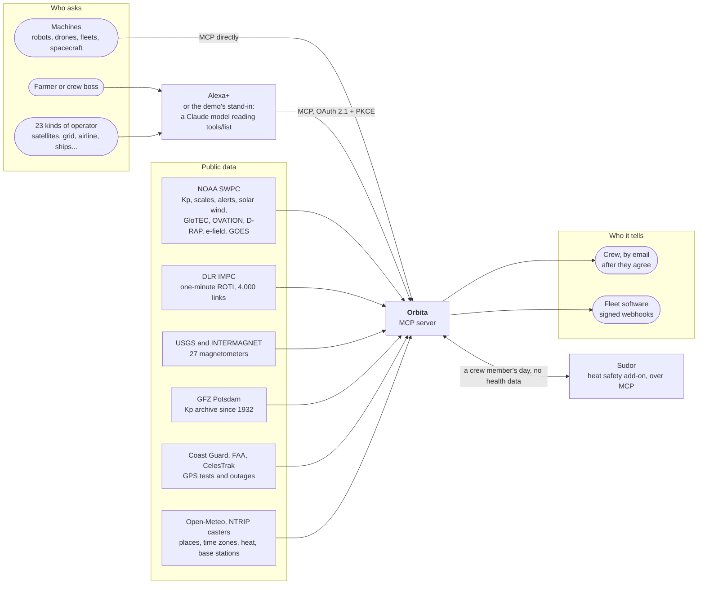
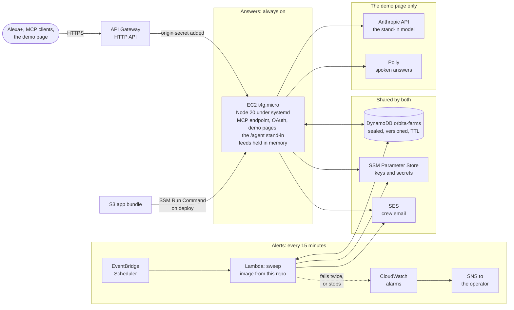
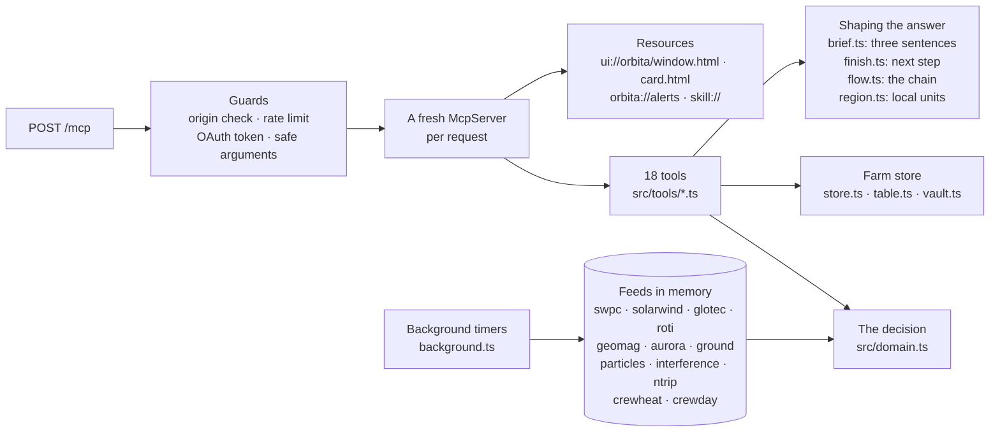
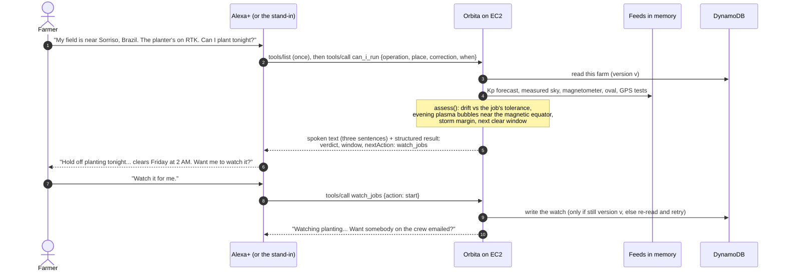
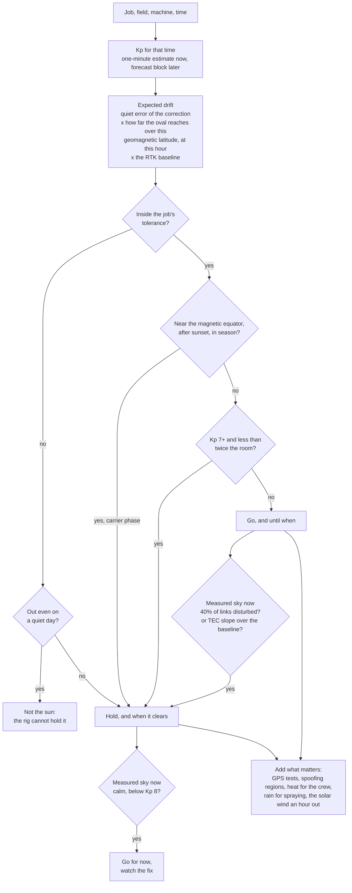
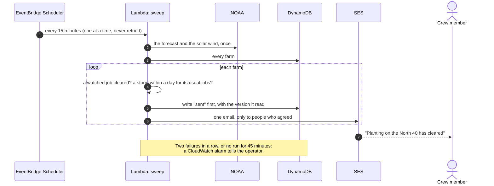
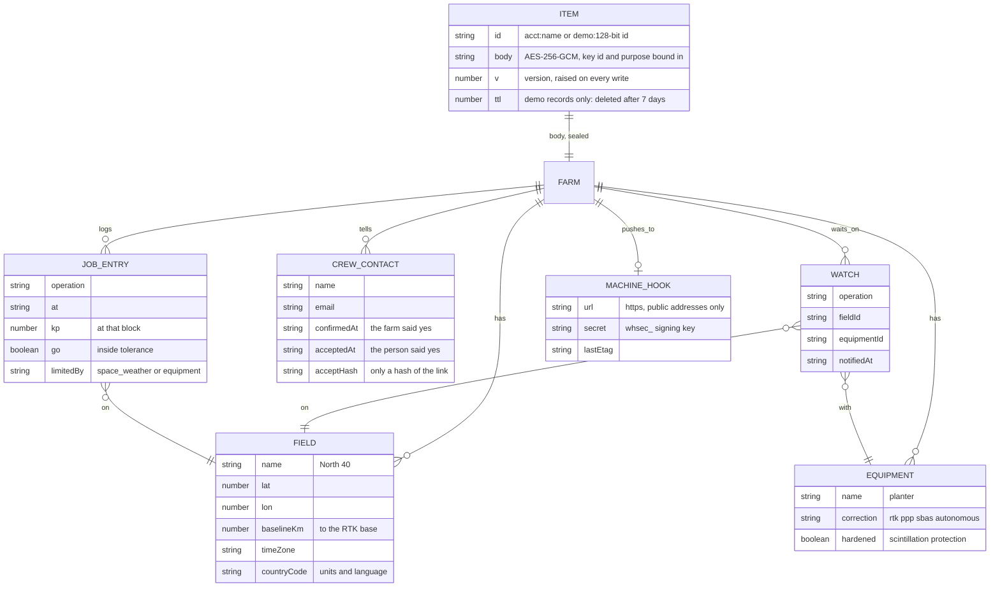
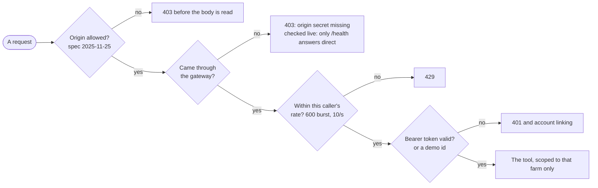
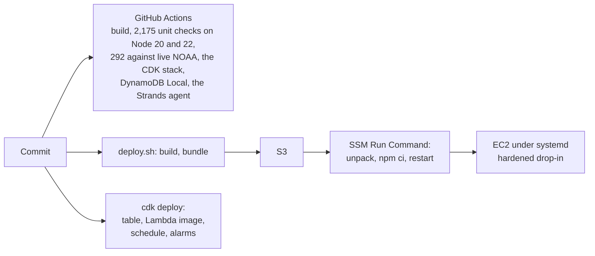

# Orbita: architecture

How Orbita is built, what runs where, and why. Every diagram below is drawn by GitHub from the text in this file, so
it can be zoomed and panned in place, and it changes when the file does. A printable copy is in
[architecture.pdf](architecture.pdf).

What is described here is what runs. It was checked against the AWS account on 22 October 2026: the farms table holds
205 records, the alert check runs every fifteen minutes and both of its alarms read OK.

**Contents.** [At a glance](#at-a-glance) · [1. Context](#1-context-who-and-what-it-talks-to) ·
[2. On AWS](#2-on-aws-what-runs-where) · [3. Inside the server](#3-inside-the-server) ·
[4. A voice turn](#4-a-voice-turn-from-sentence-to-spoken-answer) · [5. The decision](#5-the-decision-go-or-hold) ·
[6. Storm alerts](#6-storm-alerts-when-nobody-asks) · [7. The data](#7-the-data-what-a-farm-record-holds) ·
[8. Consent](#8-consent-who-may-be-emailed) · [9. Security](#9-security) · [10. Shipping it](#10-shipping-it) ·
[11. Decisions](#11-decisions-and-why)

## At a glance

| | |
|---|---|
| Protocol | MCP 2025-11-25 over Streamable HTTP, stateless: a new server and transport per request |
| Surface | 18 tools by default, an MCP Apps panel and card, an Agent Skill as `skill://` resources, the `orbita://alerts` feed |
| Answer time | Under 13 ms at p95 for every in-memory tool ([LATENCY.md](../LATENCY.md)); Alexa+ allows about 500 ms |
| Data in | More than a dozen public feeds, read on timers from every minute to every hour, never inside a turn |
| Where it runs | One EC2 instance (t4g.micro, arm64) behind an API Gateway HTTP API, us-east-1 |
| Where farms live | DynamoDB `orbita-farms`, one sealed item per farm, versioned writes, on-demand |
| Alerts | A Lambda run by EventBridge Scheduler every 15 minutes, alarmed in CloudWatch |
| Code | TypeScript on Node 20, about 16,000 lines in `src/`, 2,467 automated checks |

## 1. Context: who and what it talks to

People and machines ask; Alexa+ (or the stand-in on the demo page) chooses a tool; Orbita answers from data it already
holds. Everything on the right is public data, read in the background.

## 2. On AWS: what runs where

One small always-on instance answers every request; a separate Lambda sends the alerts so they do not depend on the
server staying up. Both read and write the same table.

Defined as code: the table, the Lambda, the schedule and the alarms are one CDK stack in [`infra/`](../infra/); the
instance, its hardening and the deploy are in [`deploy/`](../deploy/). There is no SSH: administration goes through
SSM.

## 3. Inside the server

Every request builds its own MCP server and closes it when the response ends. What makes that cheap is that nothing a
tool needs is fetched while it runs: the feeds are already in memory.

| Folder or file | Holds |
|---|---|
| `src/server.ts` | The routes, one MCP server per request, health, shutdown |
| `src/tools/` | The tools, one file per job: decide, history, setup, crew, records, roles, agents, schedule, season, discovery |
| `src/domain.ts` | Tolerances, geomagnetic latitude, the auroral oval, plasma bubbles, windows: the one model every answer uses |
| `src/standin.ts`, `src/agent.ts`, `src/rules.ts` | The Alexa+ stand-in: a model turn, and the word rules when no model runs |
| `src/store.ts`, `src/table.ts`, `src/vault.ts` | Farm records, DynamoDB with version checks, sealing |
| `src/alerts.ts`, `src/sweep.ts`, `src/lambda.ts` | The storm and clear-window alerts, and the Lambda that runs them |

## 4. A voice turn: from sentence to spoken answer

The model chooses the tool and says the answer; it never makes the decision. The server's own work in that turn is a
few milliseconds; the rest is the host and the network.

## 5. The decision: go or hold

`can_i_run`, as code decides it ([`src/tools/decide.ts`](../src/tools/decide.ts), [`src/domain.ts`](../src/domain.ts)).

## 6. Storm alerts: when nobody asks

An add-on cannot make an Echo speak first, so the alert runs on its own clock.

Machines get the same alert as `orbita://alerts` to poll, with an `etag` that changes only when an alert does, or
pushed to their own https address by `alert_my_machines`, signed to the Standard Webhooks format.

## 7. The data: what a farm record holds

One DynamoDB item per farm or demo visitor. The body is sealed, so the table never holds a field's location or a
crew member's address in the clear.

Lists are capped (fields, machines, crew, log, alerts sent), higher for linked accounts than for demo visitors. Account
tokens are stored as SHA-256 hashes and passphrases with scrypt, in a sealed file on the instance.

## 8. Consent: who may be emailed

The farm adding somebody is not that person agreeing. Nothing but one invitation is sent until they do.

```mermaid
stateDiagram-v2
  [*] --> Staged: crew_contact add
  Staged --> Confirmed: the farm says yes
  Confirmed --> Invited: one invitation (at most once a day)
  Invited --> Accepted: the person presses Yes on the page
  Invited --> Declined: the person presses No
  Accepted --> Emailed: a watched job clears, or a storm is coming
  Emailed --> Accepted
  Accepted --> Stopped: the stop link in any email
  Staged --> [*]: crew_contact remove
  Accepted --> [*]: crew_contact remove
  Declined --> [*]
  Stopped --> [*]
```

Opening the invitation does not accept it: a mail scanner opens every link, and a scanner is not a person agreeing. The
demo page never sends email; the invitation appears on the phone beside the screen, with the real links.

## 9. Security

- **Account linking** is OAuth 2.1 with PKCE (S256 only), in the static-client shape Alexa+ uses: Alexa's redirect
  URIs per region, registration closed once they are set, refresh tokens rotated, a replayed one revokes the family.
- **At rest**, every farm and the token file are sealed with AES-256-GCM; the key lives in SSM and is fetched to tmpfs
  at start. A wrong key stops the server rather than starting it empty.
- **Spend** on the model and on speech has a per-caller bucket and a daily cap; a demo visitor cannot send email.
- **Webhooks** go to public https addresses only, checked when sending and connected to as checked, with no redirects.
- **Logs** hold a hash of who asked, never field names, coordinates or addresses.

## 10. Shipping it

## 11. Decisions, and why

- **Stateless, one server per request.** A restart costs nothing and every answer is independent. The one thing that
  outlives a request, the season plan's task, has its own shared store.
- **Feeds in the background, never in a turn.** A voice turn has about half a second. A live call to NOAA can take that
  on its own; a value in memory takes microseconds. When a feed is down, the last good one is used and its age is said.
- **An instance, not a Lambda, for the server.** A cold start eats the turn budget, and the feeds are worth keeping in
  memory between calls. The alerts, which must run whether the server is up or not, are the part on Lambda.
- **DynamoDB with version checks.** The server and the alert Lambda both write the same farm; each write says which
  version it read, so neither overwrites the other.
- **Code decides; the model talks.** Every verdict and number is computed, so no rewording can turn "hold off" into
  "probably fine". The stand-in's reply is checked: it may not drop an emergency number or the reason the answer is
  about this customer.
- **What is measured outranks what is forecast, and only in one direction where it is coarse.** The one-minute
  disturbance overhead can turn a forecast yes into a no and, below Kp 8, a no into a go for now; the coarser
  ionosphere map can only add a no.
- **A source that could not be read is never clear.** It moves a machine to `verify` and says what was not checked.
